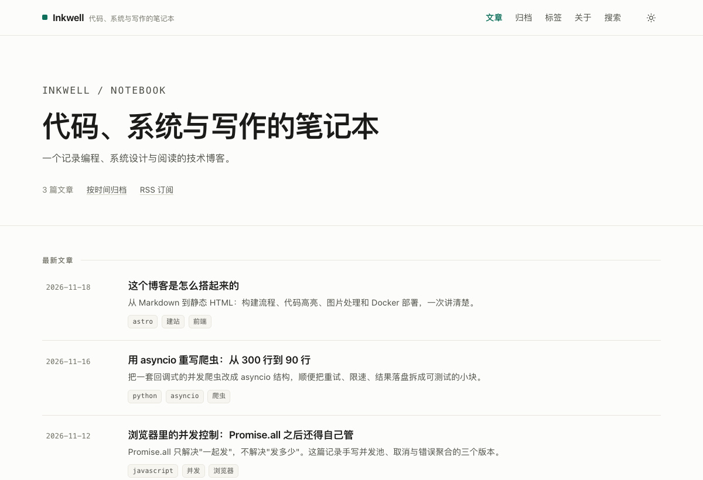
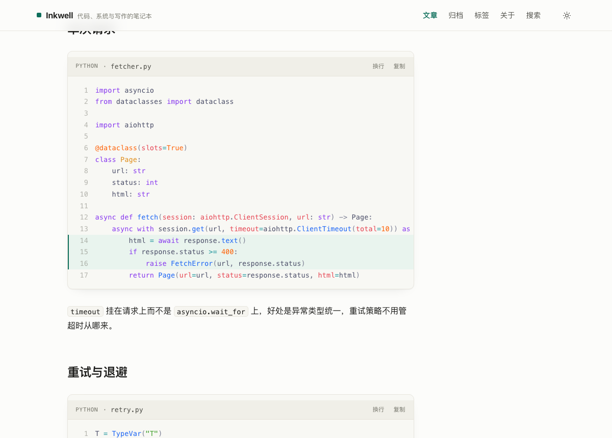
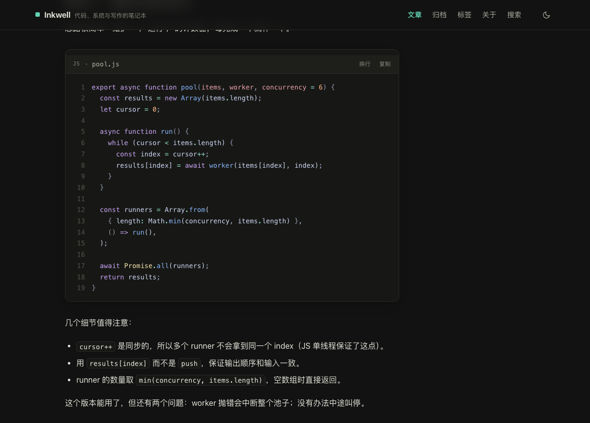

# Inkwell



一个极简的个人技术博客：Markdown 写作、构建期渲染、纯静态部署。

- **代码是主角**：Shiki（VS Code 同款 TextMate 语法）+ 行号、标题栏、diff、行高亮、聚焦、错误提示、折叠、复制、自动换行
- **没有运行时框架**：产物只有 HTML / CSS / 一点点渐进增强 JS
- **两种主题**：明暗双主题，构建期同时产出两套配色变量，切换零闪烁
- **内容可移植**：一篇文章一个 `.md` / `.mdx`，十年后任何工具都能读
- **自带搜索**：构建期生成索引，支持中英文子串匹配
- **自托管友好**：多阶段 Docker 构建 + nginx，一条命令起站

---

## 快速开始

```bash
npm install        # 首次
npm run dev        # http://localhost:4321
npm run build      # 产物在 dist/
npm run preview    # 本地预览构建结果
```

要求 Node.js ≥ 22（开发用 24）。

---

## 写作

### 新建一篇文章

在 `src/content/posts/` 下建文件，**文件名就是 URL**：

```bash
touch src/content/posts/rust-ownership.md   # → /posts/rust-ownership/
```

文件头写 frontmatter：

```yaml
---
title: 用 asyncio 重写爬虫
description: 一句话摘要，用于列表、SEO 和搜索结果
date: 2026-11-16
updated: 2026-11-18          # 可选
tags: [python, asyncio, 爬虫]
category: 后端                # 可选
series:                      # 可选，标记连载
  name: 异步爬虫实战
  order: 2
draft: false                 # true 时只在 dev 环境可见
cover: ./assets/cover.png    # 可选，文章头图
coverAlt: 封面描述
toc: true                    # 可选，默认 true
lang: zh                     # 可选，默认 zh
---
```

字段类型由 `src/content.config.ts` 里的 zod schema 校验，写错会在构建时直接报错。

### 文件类型

| 位置 | 用途 | 路由 |
| --- | --- | --- |
| `src/content/posts/*.md` | 文章 | `/posts/<文件名>/` |
| `src/content/posts/*.mdx` | 可以用组件的文章 | 同上 |
| `src/content/pages/*.md` | 关于等独立页面 | 由 `src/pages/*.astro` 决定 |

---

## 代码块



暗色主题下（`?theme=dark` 可预览）：



围栏后面可以跟一组 meta，控制渲染效果：

| meta | 作用 | 默认 |
| --- | --- | --- |
| `title="spider.py"` | 顶部显示文件名 | 不显示 |
| `showLineNumbers` | 强制显示行号 | ≥ 8 行自动显示 |
| `noLineNumbers` | 强制不显示行号 | — |
| `start=10` | 行号从 10 开始 | 1 |
| `{1,3-5}` | 高亮指定行 | — |
| `/keyword/` | 高亮关键词 | — |
| `collapse` | 超过 12 行时默认收起 | 不收起 |
| `no-copy` | 隐藏复制按钮 | 显示 |
| `wrap` | 默认自动换行 | 横向滚动 |

示例：

````markdown
```python title="spider.py" showLineNumbers {3,8-10}
async def fetch(session, url):
    ...
```
````

### 代码内的行级标记

在代码行末尾加注释即可，注释本身不会渲染出来：

| 写法 | 效果 |
| --- | --- |
| `// [!code ++]` / `# [!code ++]` | 新增行（绿色 + `+`） |
| `// [!code --]` / `# [!code --]` | 删除行（红色 + `−`） |
| `// [!code focus]` | 聚焦，其余行变淡 |
| `// [!code highlight]` | 高亮当前行 |
| `// [!code error]` | 错误行 |
| `// [!code warning]` | 警告行 |
| `// [!code word:JSON]` | 高亮某个词 |

```js
const cache = new Map();
const value = await fetchValue(key); // [!code ++]
```

> 行号用 CSS counter 渲染，不在 DOM 文本里；复制按钮拿到的是去掉标记后的干净源码。

### 支持的语言

Shiki 内置全部常用语言，写 `python`、`js`、`ts`、`jsx`、`tsx`、`json`、`bash`、`sql`、`yaml`、`html`、`css`、`diff`、`md`、`rust`、`go` 都可以。语言写错时 Shiki 会回退成 `plaintext` 并在构建日志里警告。

---

## 图片

把图片放在文章同目录的 `assets/` 下，用相对路径引用：

```markdown

```

构建时会自动：

- 读取原始尺寸，生成多种宽度的 WebP（`srcset`）
- 输出 `width` / `height`，避免布局抖动
- 懒加载
- 点击放大（灯箱）

头图用 frontmatter 的 `cover`，渲染成 `<Image>` 并带上响应式尺寸。

> 图片体积由构建期处理，仓库里只存原图。换图后记得重新构建。

---

## 目录结构

```text
blog/
├─ src/
│  ├─ content/
│  │  ├─ posts/              # 文章
│  │  │  └─ assets/          # 文章配图
│  │  └─ pages/              # 独立页面
│  ├─ components/            # 导航、页脚、目录、提示块、文章列表
│  ├─ layouts/               # BaseLayout / PageLayout
│  ├─ pages/                 # 路由：首页、文章、标签、归档、搜索、RSS
│  ├─ lib/
│  │  ├─ code/frame.ts       # 代码块包装（标题栏、按钮、meta 解析）
│  │  ├─ posts.ts            # 文章查询与排序
│  │  ├─ format.ts           # 日期、阅读时长
│  │  └─ search.ts           # 文本抽取
│  ├─ scripts/               # 交互：主题、复制、灯箱、目录高亮、搜索
│  ├─ styles/global.css      # 设计变量 + 全部样式
│  └─ content.config.ts      # frontmatter schema
├─ deploy/                   # nginx.conf、Caddyfile
├─ tools/make-images.py      # 演示图生成脚本
├─ astro.config.mjs
├─ Dockerfile
└─ docker-compose.yml
```

---

## 配置

### 站点信息

改 `src/config.ts`：

```ts
export const SITE = {
  title: 'Inkwell',
  author: 'Inkwell',
  tagline: '代码、系统与写作的笔记本',
  description: '一个记录编程、系统设计与阅读的技术博客。',
  nav: [...],
  links: { github: '...', email: '' },
};
```

### 域名

canonical、OG、RSS、sitemap 里的绝对地址都来自**构建期**的 `SITE_URL`：

```bash
SITE_URL=https://blog.your-domain.com npm run build
```

换域名必须重新构建，改 nginx 配置没有用。

### 配色与排版

全部设计变量在 `src/styles/global.css` 顶部的 `:root` 和 `html[data-theme="dark"]` 里：

```css
:root {
  --bg: #fcfcfa;
  --text: #1b1b19;
  --accent: #0e6f5b;      /* 链接、强调色 */
  --measure: 68ch;        /* 正文行宽 */
  --code-bg: #f8f8f4;
}
```

代码配色在 `astro.config.mjs`：

```js
shikiConfig: {
  themes: { light: 'catppuccin-latte', dark: 'catppuccin-mocha' },
}
```

换成 `github-light` / `github-dark-dimmed`、`vitesse-*`、`min-*` 都可以，Shiki 内置 60+ 主题。

---

## 部署

### GitHub Pages

静态站可以直接托管在 GitHub Pages。仓库名用 `<用户名>.github.io` 时站点在根路径，开箱即用：

1. 新建仓库 `<用户名>.github.io`，把本目录 push 到 `main`
2. 仓库 **Settings → Pages → Build and deployment → Source** 选 **GitHub Actions**
3. `.github/workflows/deploy.yml` 会自动 `npm ci` + 构建 + 发布，约 1 分钟
4. 访问 `https://<用户名>.github.io`

两个必须注意的点：

- **`public/.nojekyll` 不能删**。GitHub Pages 默认跑 Jekyll，会忽略 `_astro/` 这种下划线开头的目录，结果是样式和图片全 404。
- **`SITE_URL` 在构建期注入**，workflow 里已经用 `github.repository_owner` 拼好。换成自定义域名时改 workflow 里那一行，并在 `public/` 下放一个内容为域名的 `CNAME` 文件。

仓库名如果不是 `<用户名>.github.io`，站点会落在 `https://<用户名>.github.io/<仓库名>/` 子路径。默认配置没有开启 `base`，需要在 `astro.config.mjs` 里设 `base: '/<仓库名>'`，并把内部链接改成用 `import.meta.env.BASE_URL` 拼接。

免费额度对个人博客足够：仓库 1 GB、每月 100 GB 流量、Actions 构建时长另计。

### Docker（推荐）

```bash
# 首次构建（会把站点构建进镜像）
SITE_URL=https://blog.your-domain.com docker compose up -d --build

# 打开 http://<服务器IP>:8080
```

镜像分两阶段：`node:24-alpine` 里构建，`nginx:alpine` 里只放静态产物。最终镜像约 60 MB。

常用参数（写在 `.env` 里）：

```bash
SITE_URL=https://blog.your-domain.com
BLOG_PORT=8080
NPM_REGISTRY=https://registry.npmmirror.com
```

### 自动 HTTPS

内置 Caddy 反向代理，会自动申请 Let's Encrypt 证书：

```bash
BLOG_DOMAIN=blog.your-domain.com docker compose --profile tls up -d
```

前置条件：域名 A 记录指向服务器，80/443 端口放通。

### 不用 Docker

```bash
SITE_URL=https://blog.your-domain.com npm run build
rsync -az --delete dist/ user@server:/srv/blog/
```

服务器上的 nginx 直接参考 `deploy/nginx.conf`。

### 部署到静态托管

`dist/` 是纯静态目录，Cloudflare Pages、Vercel、Netlify、GitHub Pages 都能直接托管。构建命令 `npm run build`，产物目录 `dist`。

---

## 维护

| 需求 | 做法 |
| --- | --- |
| 草稿 | frontmatter 写 `draft: true`，只在 `npm run dev` 可见 |
| 搜索索引 | 构建时自动生成 `dist/search-index.json`，无需手动维护 |
| RSS | `/rss.xml`，构建时生成 |
| sitemap | `/sitemap-index.xml`，自动排除 `/lab`、`/search`、`/404` |
| 检查代码块渲染 | 打开 `/lab`，所有 meta 写法都有样例 |

---

## 常见问题

**Q：为什么构建这么慢？**
首次安装依赖慢，之后每次构建约 1–3 秒（不含图片优化）。

**Q：中文标签 URL 会变成乱码吗？**
标签用 `encodeURIComponent` 生成链接，nginx / 静态托管都能正确处理。不喜欢的话把标签改成英文即可。

**Q：能加评论吗？**
可以接 giscus（基于 GitHub Discussions），在 `BaseLayout` 里加一段 script 即可，不需要后端。

**Q：能加公式吗？**
装 `remark-math` + `rehype-katex`，在 `astro.config.mjs` 的 markdown 配置里挂上，再引入 KaTeX 样式。

**Q：图片放在 `public/` 还是 `assets/`？**
跟文章相关的放 `assets/`（会被优化），站点图标之类固定资源放 `public/`（原样拷贝）。
