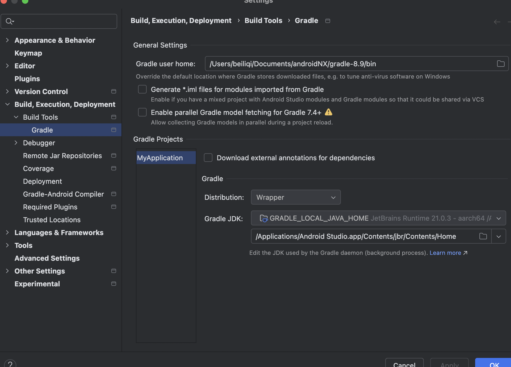
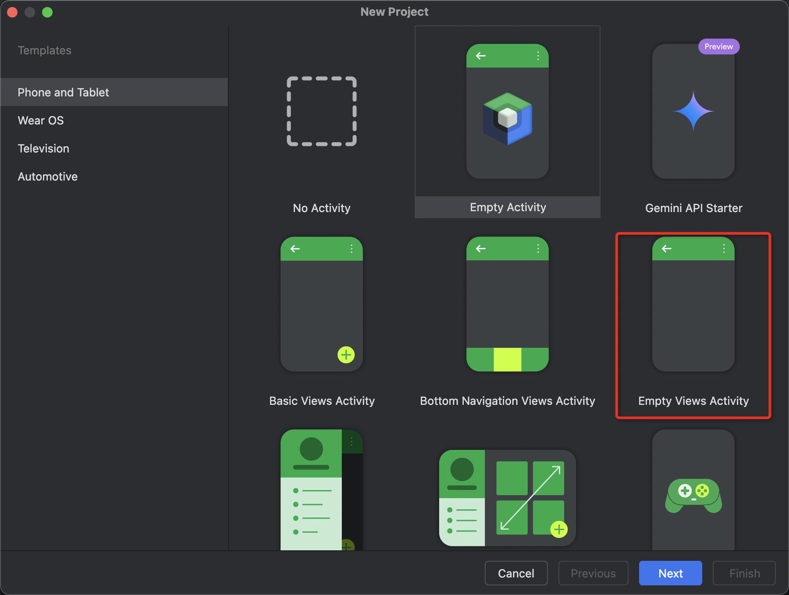
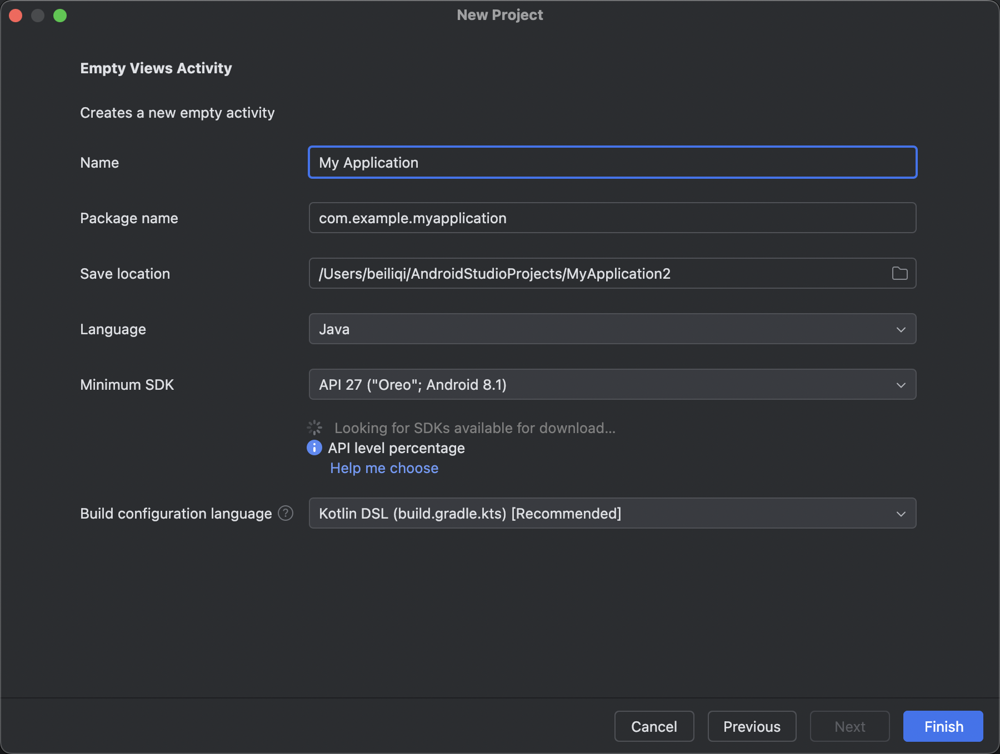
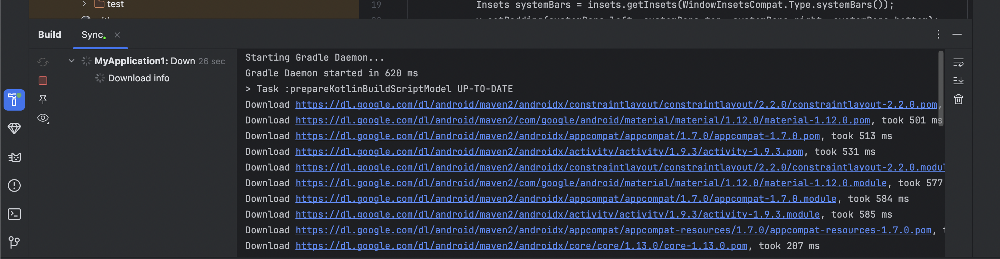
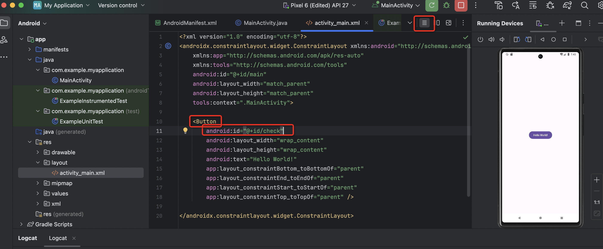
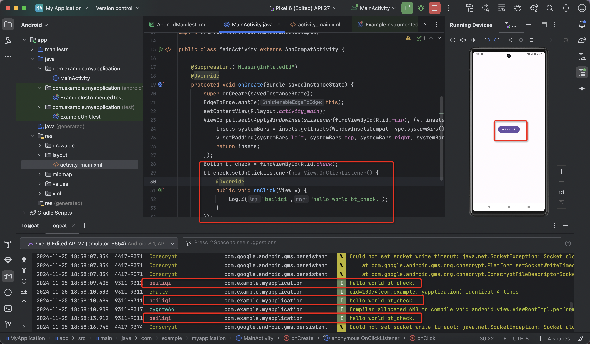

# 一、安装 Android studio

**参考教程**[**https://developer.android.google.cn/studio/install?hl=zh-cn**](https://developer.android.google.cn/studio/install?hl=zh-cn)

# 二、配置基础环境

### 1. 基础环境配置

#### 1.1 Gradle 路径配置

Gradle 是 Android Studio 构建项目的重要工具，但通过 Android Studio 自动下载可能较慢，推荐手动下载并配置。

##### 步骤：

### 2、java jdk配置

可以在网上自行搜索下载，路径手动配置

# 三、创建工程

### 1. 创建新项目

1. 打开 Android Studio，点击 `New Project` 开始创建新项目。
2. 选择模板：

### 2、填写项目信息

点击 `Next` 进入项目设置页面，完成以下选项的填写：

### 3. 完成项目创建

1. 检查所有选项无误后，点击 **Finish** 完成新项目创建。
2. 等待环境同步：

# 四、Hello world

### 1、修改这三处，分别为：

i) 切换为代码模式

ii) 更改为 Button 控件

iii) 给控件分配一个 Android Id，代号为 check

### 2、代码与界面绑定

1、在MainActivity.java文件中，新增如下代码，实现当点击按钮时，在logcat中输出日志

`Button bt_check = findViewById(R.id.check);
bt_check.setOnClickListener(new View.OnClickListener() {
    @Override
    public void onClick(View v) {
        Log.i("beiliqi","hello world bt_check.");
    }
});`

