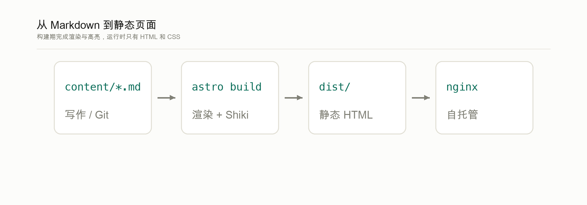

import Callout from '../../components/Callout.astro';

这个站点没有数据库，没有后台，也没有运行时框架。一篇文章就是一个 Markdown 文件，`git push` 之后由 CI（或者本机）构建成纯静态 HTML，扔给 nginx。

听起来很朴素，但它解决了一个真实问题：**十年后还能不能改**。Markdown 和 HTML 是最不容易过期的两种格式。

## 构建流程



构建分三步：

1. Astro 读取 `src/content/posts/` 下的 `.md` / `.mdx`，用 zod 校验 frontmatter。
2. 渲染 Markdown，代码块交给 Shiki 在构建期着色，输出带颜色的 HTML。
3. 生成路由、RSS、sitemap，产物全部落在 `dist/`。

<Callout type="tip" title="为什么在构建期高亮">
运行时的语法高亮库（比如 highlight.js 的浏览器版）要在客户端下载语法文件、解析、再着色，首屏会闪一下白。构建期做完，页面里只有静态 HTML 和 CSS，没有闪烁，也不需要 JS。
</Callout>

## 目录长这样

```text
blog/
├─ src/
│  ├─ content/
│  │  ├─ posts/            # 文章，文件名即 URL
│  │  │  └─ assets/        # 文章配图
│  │  └─ pages/            # 关于等独立页面
│  ├─ components/          # 导航、目录、提示块
│  ├─ layouts/             # 基础布局
│  ├─ pages/               # 路由
│  ├─ styles/global.css    # 设计变量与全部样式
│  └─ content.config.ts    # frontmatter schema
├─ astro.config.mjs
├─ Dockerfile
└─ docker-compose.yml
```

一篇文章的 frontmatter 只有几个字段，写错类型会在构建时报错，不会静默生成一个坏页面：

```yaml title="src/content/posts/example.md"
title: 用 asyncio 重写爬虫
description: 一句话摘要，用于列表和 SEO
date: 2026-11-16
tags: [python, asyncio]
category: 后端
draft: false
```

## 代码块是核心

技术博客里，代码块的观感决定了整站的质感。这里用 Shiki（VS Code 同款 TextMate 语法），并且在围栏的 meta 里支持一组开关：

````markdown
```python title="spider.py" showLineNumbers {3,8-10}
async def fetch(session, url):
    ...
```
````

渲染出来就是带文件名、行号和重点行的样子：

```python title="spider.py" showLineNumbers {3,8-10}
async def fetch(session: ClientSession, url: str) -> Page:
    timeout = ClientTimeout(total=10)
    async with session.get(url, timeout=timeout) as response:
        if response.status >= 400:
            raise FetchError(url, response.status)
        return Page(url=url, status=response.status, html=await response.text())
```

改动对比用注释标记，渲染成 diff：

```diff
- const timeout = 3000;
+ const timeout = 8000;
```

<Callout type="note" title="复制出来的是干净代码">
行号是 CSS counter 绘制的，不在 DOM 文本里；diff 的 `+` / `-` 前缀会被单独标记为不可选中。所以点"复制"拿到的就是能直接粘贴运行的源码。
</Callout>

## 图片

图片放在文章同目录的 `assets/` 下，用相对路径引用，Astro 会在构建时读取尺寸、生成多种宽度的 WebP/AVIF，并输出 `srcset`：

```markdown

```

页面上点击图片可以放大查看，这是页面上少数几个需要 JS 的交互之一。

## 样式

CSS 是手写的，没有引入 Tailwind。全部设计变量集中在 `:root` 和 `html[data-theme="dark"]` 两个块里，改配色只需要动十几个变量：

```css title="src/styles/global.css"
:root {
  --bg: #fcfcfa;
  --text: #1b1b19;
  --accent: #0e6f5b;
  --measure: 68ch;
}

html[data-theme="dark"] {
  --bg: #111211;
  --text: #e8e6de;
  --accent: #63d3b2;
}
```

正文宽度限制在 `68ch` 左右，这是长文阅读比较舒服的行长；代码块可以横向滚动，不挤压正文。

## 部署

多阶段构建，产物只有几 MB：

```dockerfile title="Dockerfile"
FROM node:24-alpine AS build
WORKDIR /app
COPY package*.json ./
RUN npm ci
COPY . .
RUN npm run build

FROM nginx:alpine
COPY nginx.conf /etc/nginx/conf.d/default.conf
COPY --from=build /app/dist /usr/share/nginx/html
```

<Callout type="warn" title="域名要在构建期确定">
canonical、RSS 和 sitemap 里的绝对地址都来自构建期的 `SITE_URL`。换域名必须重新构建，不能只改 nginx 配置。
</Callout>

## 已知的局限

- **搜索是自建的**。构建时把每篇文章压成纯文本索引，前端做子串匹配。文章上千篇以后需要换成分词索引。
- **没有评论**。需要的话接 giscus，或者干脆留邮箱。
- **没有后台**。写作在本地编辑器里完成，这对写代码的人来说不是问题。

对一个个人博客来说，这些取舍是划算的：维护成本接近于零，而内容始终是可读的纯文本。
