Gerapy 是一个基于 Scrapy 的分布式爬虫框架，旨在为大规模爬虫任务提供更高效的管理和调度功能。它支持分布式任务调度、集中式配置管理、爬虫任务监控和日志管理等功能，非常适合用于多节点分布式环境下的大规模数据抓取。

## 一、概述

### 1、概述

Gerapy的主要特性：

1、**Web界面管理**：通过 Web 界面方便地管理和监控爬虫项目，可视化展示爬取数据和日志。

2、**分布式部署**：支持将爬虫项目部署到多台服务器上，实现分布式爬取，提高爬取效率。

3、**定时任务**：支持设置定时任务，定期运行爬虫程序，自动获取最新数据。

4、**爬虫项目管理**：提供统一的界面管理爬虫项目，包括配置、部署、启动、停止等操作。

5、**日志管理**：记录爬虫项目的运行日志，方便用户查看和分析爬取过程。

6、**支持多平台**：Gerapy支持Python 3.5及以上版本，可以运行在Linux、Windows和MacOS系统上。

7、**二次开发**：Gerapy还提供了RESTful API和CLI命令行接口，方便用户进行二次开发和集成。

### 2、安装依赖

```python
# macos & linux 激活虚拟环境
source env-python38/bin/activate

# 安装依赖
pip install scrapy==2.11.2
pip install scrapy-redis==0.9.1
pip install kafka-python==2.0.2
pip install urllib3==1.26.15
pip install scrapyd==1.5.0
pip install gerapy==0.9.13
```

## 二、scrapyd配置启动

### 1、修改项目配置文件

在爬虫项目根目录下修改配置文件scrapy.cfg

gerapy/projects/Ldoscrapyproducts/scrapy.cfg

```python
[deploy]
#url = http://localhost:6800/
project = Ldoscrapyproducts

# 修改如下

[deploy:Ldoscrapyproducts]
url = http://localhost:6800/ # 服务器地址
project = Ldoscrapyproducts
```

### 2、配置 scrapyd

为了让 Scrapyd 能够识别和管理我们的爬虫项目，需要在项目根目录创建一个名为scrapyd.conf的配置文件，如下所示：

```python
[scrapyd]
# 项目的 eggs 存储位置
eggs_dir    = eggs
# Scrapy日志的存储目录。如果要禁用存储日志，请将此选项设置为空，如下
# logs_dir = 
logs_dir    = logs
# Scrapyitem将被存储的目录，默认情况下禁用此选项，如果设置了 值，会覆盖 scrapy的 FEED_URI 配置项
items_dir   =
# 每个蜘蛛保持完成的工作数量。默认为5
jobs_to_keep = 5
# 项目数据库存储的目录
dbs_dir     = dbs
# 并发scrapy进程的最大数量，默认为0，没有设置或者设置为0时，将使用系统中可用的cpus数乘以max_proc_per_cpu配置的值
max_proc    = 0
# 每个CPU启动的进程数，默认4
max_proc_per_cpu = 4
# 保留在启动器中的完成进程的数量。默认为100
finished_to_keep = 100
# 用于轮询队列的时间间隔，以秒为单位。默认为5.0
poll_interval = 5.0
# webservices监听地址
bind_address = 0.0.0.0
# 默认 http 监听端口
http_port   = 6800
# 是否调试模式
debug       = off
# 将用于启动子流程的模块，可以使用自己的模块自定义从Scrapyd启动的Scrapy进程
runner      = scrapyd.runner
application = scrapyd.app.application
launcher    = scrapyd.launcher.Launcher
webroot     = scrapyd.website.Root

[services]
schedule.json     = scrapyd.webservice.Schedule
cancel.json       = scrapyd.webservice.Cancel
addversion.json   = scrapyd.webservice.AddVersion
listprojects.json = scrapyd.webservice.ListProjects
listversions.json = scrapyd.webservice.ListVersions
listspiders.json  = scrapyd.webservice.ListSpiders
delproject.json   = scrapyd.webservice.DeleteProject
delversion.json   = scrapyd.webservice.DeleteVersion
listjobs.json     = scrapyd.webservice.ListJobs
daemonstatus.json = scrapyd.webservice.DaemonStatus
```

### 3、启动scrapyd

服务器这个路径下后台启动 scrapyd<br>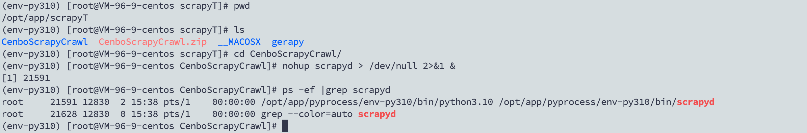

```python
# 启动scrapyd
scrapyd
# 后台启动
nohup scrapyd > /dev/null 2>&1 &
```

## 三、Gerapy配置启动

### 1、新建一个项目

在命令行执行如下命令创建一个Gerapy项目

`gerapy init`

会在当前目录下生成一个gerapy文件夹

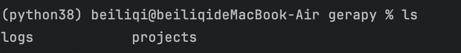

### 2、数据库初始化

进入gerapy目录，对数据库进行初始化

`gerapy migrate`

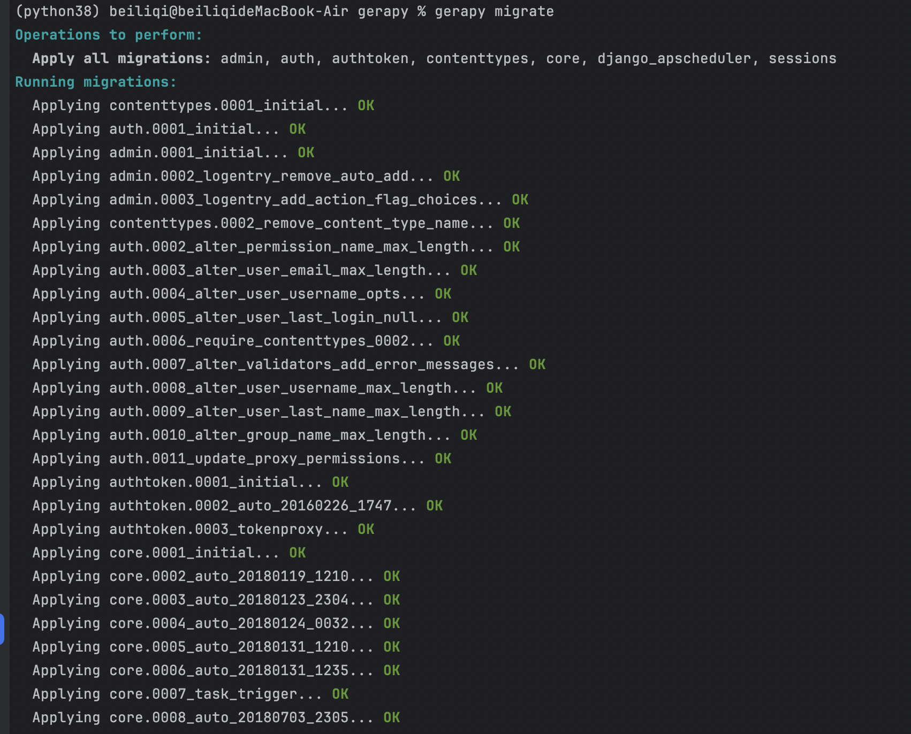

对数据库初始化之后会生成一个SQLite数据库，数据库保存主机配置信息和部署版本等


### 3、创建超级用户

创建超级用户

`gerapy createsuperuser`

根据提示完成账号密码的设置

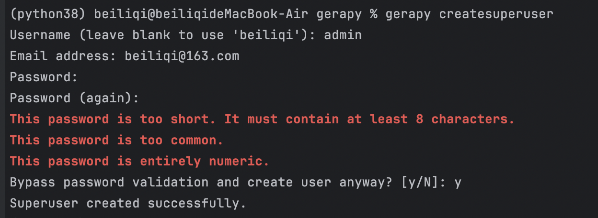

### 4、启动gerapy服务

执行命令启动gerapy服务

`gerapy runserver`

默认启动命令为gerapy reserver ，如果要更改为外部访问+更改端口号，可使用如下命令

`gerapy runserver 0.0.0.0:8080`

在服务器中可以在以下位置启动<br>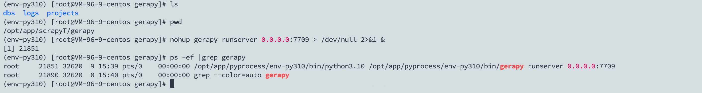

浏览器访问[http://127.0.0.1:8000](http://127.0.0.1:8000)，输入账号密码登录


## 四、Gerapy配置管理Scrapy项目

在配置主机、启动主机的前提是配置scrapyd，启动scrapyd

### 1、主机管理

在主机管理界面创建一个主机


指定Scrapy项目部署主机的名称、 IP、端口来创建一个 主机

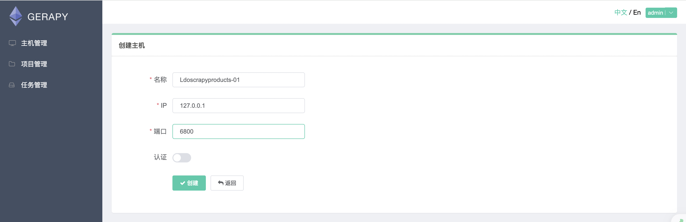

点击创建即可完成添加


点击调度，进入爬虫列表

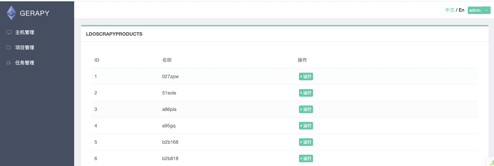

点击运行，即可启动爬虫

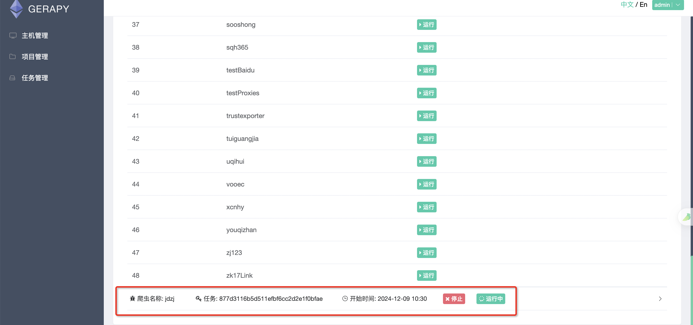

### 2、项目管理

将scarpy项目直接放到爬虫管理框架Gerapy的 `/gerapy/projects`目录下。或者直接将scarpy项目压缩上传。

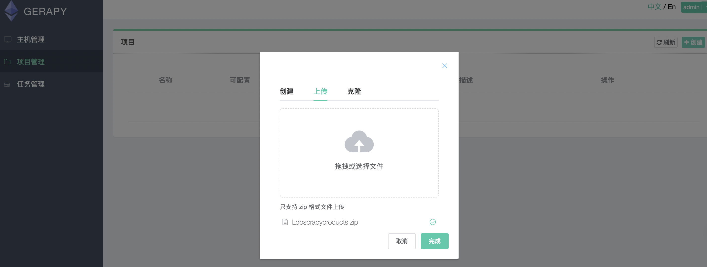

可以在gerapy后台看到有个项目

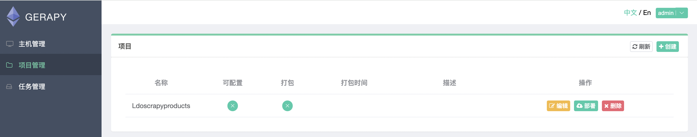

点击部署按钮进行打包和部署，可以输入打包时的描述信息

点击打包按钮，即可发现 Gerapy 会提示打包成功，同时在左侧显示打包的结果和打包名称。

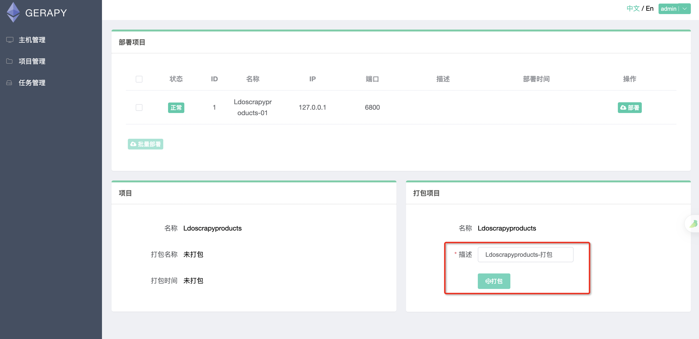

选择一个站点，点击右侧部署，将该项目部署到该站点上

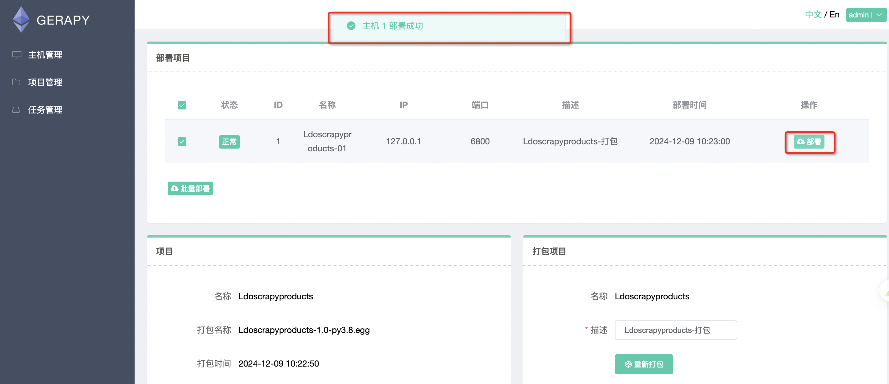

### 3、任务管理

指定定时任务处理爬虫，暂未使用

## 五、后台启动

1、后台启动scrapyd


```python
#!/bin/bash

nohup scrapyd > /dev/null 2>&1 &
```

2、后台启动gerapy


```python
#!/bin/bash

nohup gerapy runserver 0.0.0.0:7709 > /dev/null 2>&1 &
```

## 六、Gerapy配置异常处理

### 1、SQLite版本异常

```python
Traceback (most recent call last):
  File "/root/app/pyprocess/env-python3.8/bin/gerapy", line 8, in <module>
    sys.exit(cmd())
  File "/root/app/pyprocess/env-python3.8/lib/python3.8/site-packages/gerapy/cmd/__init__.py", line 171, in cmd
    manage()
  File "/root/app/pyprocess/env-python3.8/lib/python3.8/site-packages/gerapy/server/manage.py", line 24, in manage
    execute_from_command_line(sys.argv)
  File "/root/app/pyprocess/env-python3.8/lib/python3.8/site-packages/django/core/management/__init__.py", line 381, in execute_from_command_line
    utility.execute()
  File "/root/app/pyprocess/env-python3.8/lib/python3.8/site-packages/django/core/management/__init__.py", line 357, in execute
    django.setup()
  File "/root/app/pyprocess/env-python3.8/lib/python3.8/site-packages/django/__init__.py", line 24, in setup
    apps.populate(settings.INSTALLED_APPS)
  File "/root/app/pyprocess/env-python3.8/lib/python3.8/site-packages/django/apps/registry.py", line 114, in populate
    app_config.import_models()
  File "/root/app/pyprocess/env-python3.8/lib/python3.8/site-packages/django/apps/config.py", line 211, in import_models
    self.models_module = import_module(models_module_name)
  File "/usr/local/lib/python3.8/importlib/__init__.py", line 127, in import_module
    return _bootstrap._gcd_import(name[level:], package, level)
  File "<frozen importlib._bootstrap>", line 1014, in _gcd_import
  File "<frozen importlib._bootstrap>", line 991, in _find_and_load
  File "<frozen importlib._bootstrap>", line 975, in _find_and_load_unlocked
  File "<frozen importlib._bootstrap>", line 671, in _load_unlocked
  File "<frozen importlib._bootstrap_external>", line 848, in exec_module
  File "<frozen importlib._bootstrap>", line 219, in _call_with_frames_removed
  File "/root/app/pyprocess/env-python3.8/lib/python3.8/site-packages/django/contrib/auth/models.py", line 2, in <module>
    from django.contrib.auth.base_user import AbstractBaseUser, BaseUserManager
  File "/root/app/pyprocess/env-python3.8/lib/python3.8/site-packages/django/contrib/auth/base_user.py", line 47, in <module>
    class AbstractBaseUser(models.Model):
  File "/root/app/pyprocess/env-python3.8/lib/python3.8/site-packages/django/db/models/base.py", line 117, in __new__
    new_class.add_to_class('_meta', Options(meta, app_label))
  File "/root/app/pyprocess/env-python3.8/lib/python3.8/site-packages/django/db/models/base.py", line 321, in add_to_class
    value.contribute_to_class(cls, name)
  File "/root/app/pyprocess/env-python3.8/lib/python3.8/site-packages/django/db/models/options.py", line 204, in contribute_to_class
    self.db_table = truncate_name(self.db_table, connection.ops.max_name_length())
  File "/root/app/pyprocess/env-python3.8/lib/python3.8/site-packages/django/db/__init__.py", line 28, in __getattr__
    return getattr(connections[DEFAULT_DB_ALIAS], item)
  File "/root/app/pyprocess/env-python3.8/lib/python3.8/site-packages/django/db/utils.py", line 201, in __getitem__
    backend = load_backend(db['ENGINE'])
  File "/root/app/pyprocess/env-python3.8/lib/python3.8/site-packages/django/db/utils.py", line 110, in load_backend
    return import_module('%s.base' % backend_name)
  File "/usr/local/lib/python3.8/importlib/__init__.py", line 127, in import_module
    return _bootstrap._gcd_import(name[level:], package, level)
  File "/root/app/pyprocess/env-python3.8/lib/python3.8/site-packages/django/db/backends/sqlite3/base.py", line 66, in <module>
    check_sqlite_version()
  File "/root/app/pyprocess/env-python3.8/lib/python3.8/site-packages/django/db/backends/sqlite3/base.py", line 63, in check_sqlite_version
    raise ImproperlyConfigured('SQLite 3.8.3 or later is required (found %s).' % Database.sqlite_version)
django.core.exceptions.ImproperlyConfigured: SQLite 3.8.3 or later is required (found 3.7.17).
```

### 1.1、SQLite异常解决办法

```python
# 参考链接
# https://zhuanlan.zhihu.com/p/497831108
# https://www.sqlite.org/download.html
# https://www.sqlite.org/2024/sqlite-autoconf-3470100.tar.gz

#下载sqlite3
wget https://www.sqlite.org/2024/sqlite-autoconf-3470100.tar.gz

#解压并安装sqlite3
$ tar -zxvf sqlite-autoconf-3270200.tar.gz
$ cd sqlite-autoconf-3270200
$ ./configure --prefix=/usr/local
$ make && make install

#设置软链接
$ mv /usr/bin/sqlite3  /usr/bin/sqlite3_old
$ ln -s /usr/local/bin/sqlite3   /usr/bin/sqlite3

#修改.bashrc文件
vim ~/.bashrc
#在用户目录下.bashrc文件最后一行添加
export LD_LIBRARY_PATH="/usr/local/lib"

#并在终端输入立即生效命令
source ~/.bashrc
```

### 2、定时清理日志

在项目运行过程中，会产生大量的日志文件，需要对日志文件进行定时清理，解决办法如下

1、定时清理日志脚本

```python
#!/bin/bash

# 查找并清空日志
find /root/app/pyprocess/gerapy/projects/Ldoscrapyproducts/logs/Ldoscrapyproducts -type f -name "*.log" -exec truncate -s 0 {} \;
```

2、crontab 配置定时任务

```python
crontab -e 

*/10 * * * * /root/app/pyprocess/gerapy/projects/Ldoscrapyproducts/clear_logs.sh

chmod 777 clear_log.sh
```
