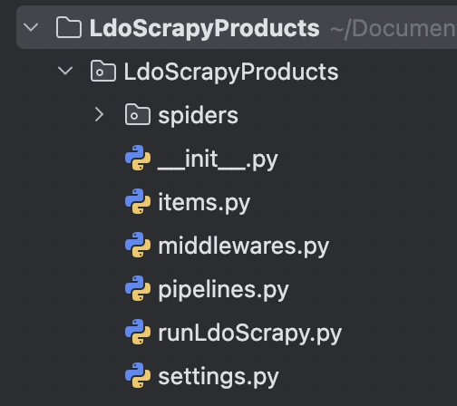
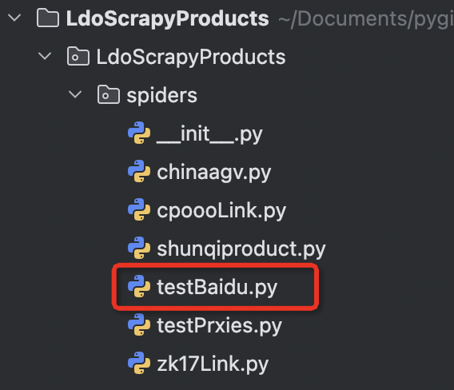
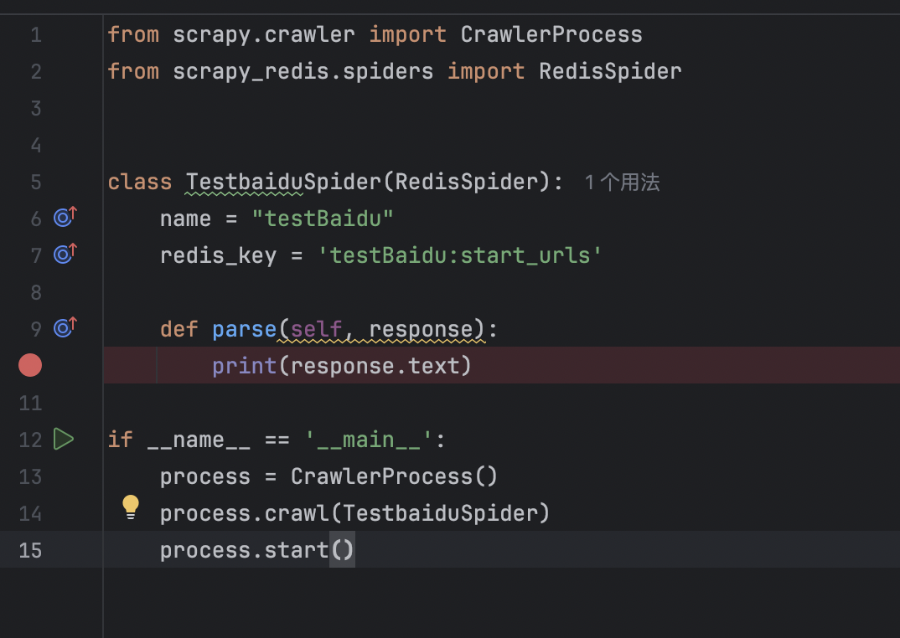

## 项目背景

在企业数据采集过程中，需要增加多个数据源进行大规模采集，而每个网站的解析逻辑都具有个性化，需独立开发和测试。为此，计划开发一套爬虫模板，将爬虫的通用功能（如任务调度、数据存储、去重、代理池等）聚合成一个独立工程，简化开发流程。开发人员可以专注于个性化解析开发，提升效率，并支持高效的分布式爬取与灵活的数据存储方式。

## 技术栈

python、scrapy、scrapy-redis、redis、Kafka

## 环境部署

服务器环境版本 python3.8.10 redis7.2.0 （scrapy、scrapy-redis 最新版本）

## 项目

### 一、创建工程

1、scrapy-redis 工程创建

`scrapy startproject JdoScrapyProducts`

生成的项目结构如下

2、进入项目

`cd LdoScrapyProducts`

3、创建一个新的 scrapy 爬虫

`scrapy genspider testBaidu https://www.baidu.com`

4、运行爬虫

`scrapy crawl testBaidu`

### 二、基础设置

通过以上步骤，可以创建出scrapy工程，包含scrapy爬虫，通过配置settings、middlewares、piplines完成分布式爬虫

#### 1、settings基本配置

`# settings.py
# 项目名称
BOT_NAME = "LdoScrapyProducts"

SPIDER_MODULES = ["LdoScrapyProducts.spiders"]
NEWSPIDER_MODULE = "LdoScrapyProducts.spiders"

# Crawl responsibly by identifying yourself (and your website) on the user-agent
# ua设置
USER_AGENT = "Mozilla/5.0 (Macintosh; Intel Mac OS X 10_15_7) AppleWebKit/537.36 (KHTML, like Gecko) Chrome/130.0.0.0 Safari/537.36"

# Obey robots.txt rules
# 关闭robot协议
ROBOTSTXT_OBEY = False

# Configure maximum concurrent requests performed by Scrapy (default: 16)
#CONCURRENT_REQUESTS = 32

# Configure a delay for requests for the same website (default: 0)
# See https://docs.scrapy.org/en/latest/topics/settings.html#download-delay
# See also autothrottle settings and docs
#DOWNLOAD_DELAY = 3
# The download delay setting will honor only one of:
#CONCURRENT_REQUESTS_PER_DOMAIN = 16
#CONCURRENT_REQUESTS_PER_IP = 16

# Disable cookies (enabled by default)
#COOKIES_ENABLED = False

# Disable Telnet Console (enabled by default)
#TELNETCONSOLE_ENABLED = False

# Override the default request headers:
DEFAULT_REQUEST_HEADERS = {
   "Accept": "*/*",
   "Accept-Encoding": "gzip, deflate, br",
   "Connection": "keep-alive"
}

# Enable or disable spider middlewares
# See https://docs.scrapy.org/en/latest/topics/spider-middleware.html
#SPIDER_MIDDLEWARES = {
#    "LdoScrapyProducts.middlewares.LdoscrapyproductsSpiderMiddleware": 543,
#}

# Enable or disable downloader middlewares
# See https://docs.scrapy.org/en/latest/topics/downloader-middleware.html
# 下载中间件
DOWNLOADER_MIDDLEWARES = {
   "LdoScrapyProducts.middlewares.LdoscrapyproductsDownloaderMiddleware": 543,
}

# Enable or disable extensions
# See https://docs.scrapy.org/en/latest/topics/extensions.html
#EXTENSIONS = {
#    "scrapy.extensions.telnet.TelnetConsole": None,
#}

# Configure item pipelines
# See https://docs.scrapy.org/en/latest/topics/item-pipeline.html
ITEM_PIPELINES = {
   # "LdoScrapyProducts.pipelines.LdoscrapyproductsPipeline": 300,
   "LdoScrapyProducts.pipelines.KafkaPipeline": 300,
}

# Enable and configure the AutoThrottle extension (disabled by default)
# See https://docs.scrapy.org/en/latest/topics/autothrottle.html
# 启用 AutoThrottle
AUTOTHROTTLE_ENABLED = True
# The initial download delay
# 设置初始下载延迟（秒）
# 每个请求间隔的最小等待时间
AUTOTHROTTLE_START_DELAY = 0.1
# The maximum download delay to be set in case of high latencies
# 最大下载延迟（秒）
# 服务器响应变慢时的最大等待时间
AUTOTHROTTLE_MAX_DELAY = 5
# The average number of requests Scrapy should be sending in parallel to
# each remote server
# 每个目标服务器的并发请求数
# Scrapy 会在此范围内调节并发请求数
AUTOTHROTTLE_TARGET_CONCURRENCY = 30
# Enable showing throttling stats for every response received:
# 启用 AutoThrottle 的调试模式
# 显示调节的下载延迟和并发数
AUTOTHROTTLE_DEBUG = False

# Enable and configure HTTP caching (disabled by default)
# See https://docs.scrapy.org/en/latest/topics/downloader-middleware.html#httpcache-middleware-settings
#HTTPCACHE_ENABLED = True
#HTTPCACHE_EXPIRATION_SECS = 0
#HTTPCACHE_DIR = "httpcache"
#HTTPCACHE_IGNORE_HTTP_CODES = []
#HTTPCACHE_STORAGE = "scrapy.extensions.httpcache.FilesystemCacheStorage"

# Set settings whose default value is deprecated to a future-proof value
REQUEST_FINGERPRINTER_IMPLEMENTATION = "2.7"
TWISTED_REACTOR = "twisted.internet.asyncioreactor.AsyncioSelectorReactor"
FEED_EXPORT_ENCODING = "utf-8"

# 使用 Scrapy-Redis 的调度器和去重方式
SCHEDULER = "scrapy_redis.scheduler.Scheduler"
# 在 settings.py 中设置去重过滤器
DUPEFILTER_CLASS = "scrapy_redis.dupefilter.RFPDupeFilter"

# # 使爬虫可以暂停和恢复
SCHEDULER_PERSIST = True

# Redis 连接配置
REDIS_HOST = '10.0.0.133'  # Redis 主机地址
REDIS_PORT = 6379        # Redis 端口

# RETRY_HTTP_CODES = [407]

# DOWNLOAD_FAIL_ON_DATALOSS = False`

#### 2、middlewares中间件配置（代理、redis）

`# middlewares.py
import random
import redis
from LdoScrapyProducts import settings

def get_proxy():
    # 连接 Redis
    redis_client = redis.StrictRedis(host=settings.REDIS_HOST, port=settings.REDIS_PORT, decode_responses=True)
    proxy = redis_client.smembers("proxyPool")
    proxies = random.choice(list(proxy)) if proxy else None
    return proxies
...
class LdoscrapyproductsDownloaderMiddleware:
	def process_request(self, request, spider):
		try:
			proxies = get_proxy()
			print("proxies ip is "+proxies)
			request.meta["proxy"] = proxies
		except:
			print("get proxy error")
		return None`

#### 3、piplines 爬虫结果处理（Kafka）

`#pipelines.py
from kafka import KafkaProducer
import json

class KafkaPipeline:
    def open_spider(self, spider):
        # 初始化Kafka生产者
        self.producer = KafkaProducer(
            bootstrap_servers=["10.0.0.134:9092","10.0.0.135:9092","10.0.0.136:9092"],  # 修改为你的Kafka服务器地址
            value_serializer=lambda v: json.dumps(v, ensure_ascii=False).encode('utf-8')
        )

    def close_spider(self, spider):
        # 关闭Kafka生产者
        self.producer.close()

    def process_item(self, item, spider):
        # 将数据推送到Kafka
        topic_name = 'cluster_product'  # 生产
        # topic_name = 'spider_test'  # 测试
        # random_key = str(random.randint(0, 2))
        # self.producer.send(topic_name,key=random_key.encode('utf-8'), value=dict(item))
        self.producer.send(topic_name,dict(item))
        return item`

#### 4、爬虫示例

1、创建爬虫

`scrapy genspider testBaidu https://www.baidu.com`

2、在spider文件夹下会生成一个爬虫文件

3、生成的爬虫文件是scrapy文件，需要调整为scrapy-redis文件

`#调整前
import scrapy
class TestbaiduSpider(scrapy.Spider):
    name = "testBaidu"    
	allowed_domains = ["www.baidu.com"]
    start_urls = ["https://www.baidu.com"]
    def parse(self, response):
        print(response.text)
# 调整后
from scrapy_redis.spiders import RedisSpider
class TestbaiduSpider(RedisSpider):
    name = "testBaidu"    
    redis_key = 'testBaidu:start_urls'    
    def parse(self, response):
        print(response.text)`

4、运行爬虫

`scrapy crawl testBaidu`

5、通过redis推送初始任务

5.1 本地连接redis

`redis-cli`

5.2 远程连接redis

`redis-cli -h 192.168.1.1 -p 6379`

5.3 进入redis后，推送初始url进入redis_key

`lpush testBaidu:start_urls https://www.baidu.com`

### 三、模板工程

#### 一、通过以上配置，可以生成爬虫模板工程，模板工程开发流程如下

##### 1、下载模板工程

通过git或zip获取模板工程

##### 2、通过命令行工具进入工程目录下

`cd ../LdoScrapyProducts`

##### 3、创建爬虫数据源工程

`scrapy genspider shunqiproduct https://www.11467.com/`

##### 4、改造scrapy文件为scrapy-redis，并对响应结果进行解析处理

⚠️调整注意事项，调整class类scrapy.Spider为RedisSpider，调整redis_key

`import scrapy
from lxml import etree
from scrapy_redis.spiders import RedisSpider

class ShunqiproductSpider(RedisSpider):
    name = "shunqiproduct"
    redis_key = 'shunqiproduct:start_urls'

    def parse(self, response):
        print("初始url解析")
		tree = etree.HTML(response.text)
        homepcat = tree.xpath('//dl[@class="homepcat"]/dd/a/@href')
        for url in homepcat:
            yield scrapy.Request(url=url, callback=self.first_parse)  # 请求列表页
    def first_parse(self, response):
        print("结果解析-示例")
        tree = etree.HTML(response.text)
        box = tree.xpath('//div[@class="box "]/div/dl/dd/a/@href')
        item = {}
		item["url"] = response.url
        item["content"] = response.text
        item["tms"] = int(time.time() * 1000)
        item["source"] = "shunqi"
        item["version"] = "1.0.1"
		item["entName"] = ""
		item["companyAddr"] = ""
		item["contactName"] = ""
		item["tel"] = ""
		item["fixedTel"] = ""
        item["faxTel"] = ""
		item["productName"] = ""
		item["productPrice"] = ""
        item["business"] = ""
        item["website"] = ""
		item["pcImg"] = ""
        item["imgContent"] = ""
        item["productDetail"] = ""
		yield item`

##### 5、启动分布式爬虫

在 Redis 中添加起始 URL（确保每个爬虫的 URL 不冲突）：

`redis-cli
127.0.0.1:6379> lpush shunqiproduct:start_urls https://www.11467.com/`

启动爬虫：

`scrapy crawl my_spider`

##### 6、对详情页内容进行解析，解析结构

`{
	"url":"请求地址",
	"content":"html",
	"tms":"抓取时间",
	"source":"数据源",
	"version":"版本",
	"entName":"公司名",
	"companyAddr":"公司地址",
	"contactName":"联系人姓名",
	"tel":"手机",
	"fixedTel":"电话",
	"faxTel":"传真",
	"productName":"产品名称",
	"productPrice":"产品价格",
	"business":"主营产品",
	"website":"公司官网",
	"pcImg":"图片链接",
	"imgContent":"图片二进制",
	"productDetail":"产品详情"
}`

#### 二、调试代码

##### 1、数据源爬虫文件中进行调试

使用这种方式对代码进行调试，可以在代码中对解析规则进行调试

`from scrapy.crawler import CrawlerProcess
from scrapy_redis.spiders import RedisSpider

class TestbaiduSpider(RedisSpider):
    name = "testBaidu"
    redis_key = 'testBaidu:start_urls'

    def parse(self, response):
        print(response.text)

if __name__ == '__main__':
    process = CrawlerProcess()
    process.crawl(TestbaiduSpider)
    process.start()`

