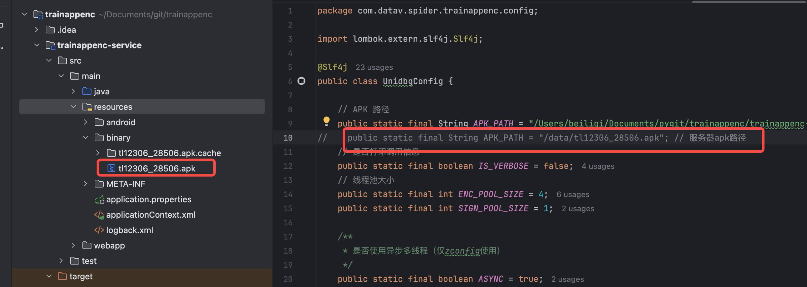
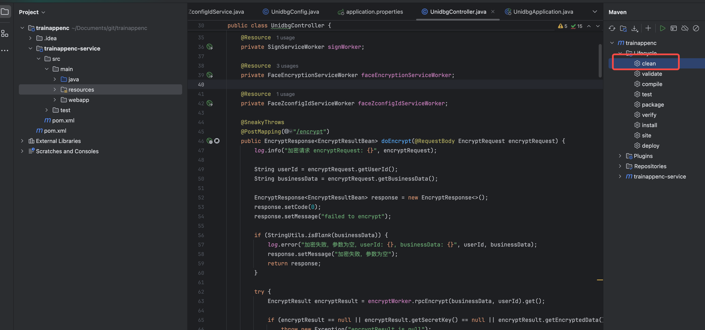
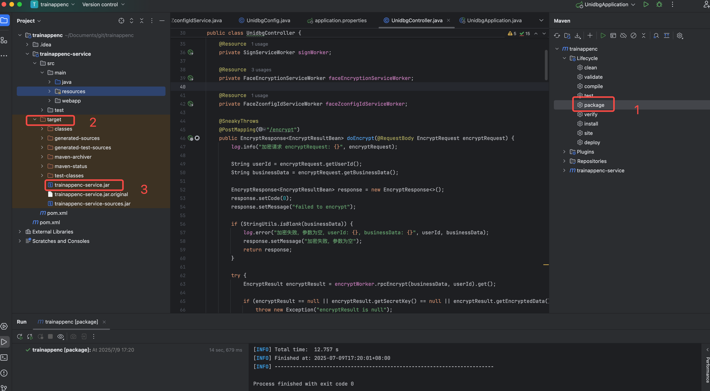
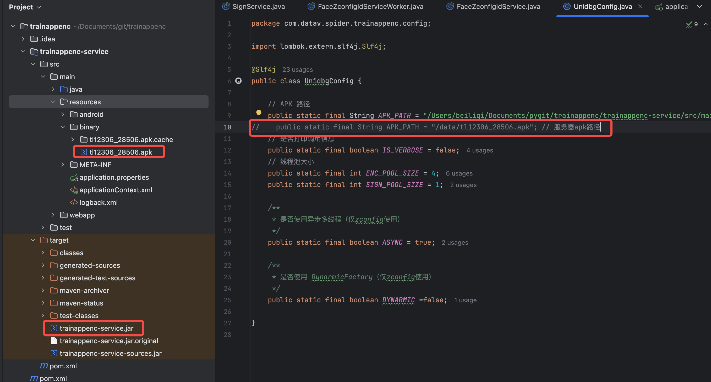

# 一、Java 工程前置

## 1、打 jar 包

#### 1.1 修改 apk 在服务器中的路径



#### 1.2 首先执行 clean



#### 1.3 执行 package

进行打 jar 包，打完 jar 包后，会生成一个 target 文件夹，生成的 jar 包文件为 trainappenc-service.jar



#### 1.4 将 jar 包文件和 apk 文件推送到服务器，其中 apk 要放到代码中配置的指定路径



# 二、Java 工程部署

## 1、查看服务器基本配置

```python
# 查看内核和系统信息
    hostnamectl
# ！！！需要 CPU 架构为x86-64  Architecture: x86-64

# 查看内存
free -h
```

## 2、安装 Java

```python
# CentOS 安装Java11
sudo yum install java-11-openjdk-devel -y

# 验证 Java 是否安装成功
java -version
# 输出示例
openjdk version "11.0.23" 2024-04-16 LTS
OpenJDK Runtime Environment (Red_Hat-11.0.23.0.9-2.el7_9) (build 11.0.23+9-LTS)
OpenJDK 64-Bit Server VM (Red_Hat-11.0.23.0.9-2.el7_9) (build 11.0.23+9-LTS, mixed mode, sharing)

# 运行jar包 -- 测试运行 生产使用systemd
java -jar trainappenc.jar

# 后台运行 -- 测试运行 生产使用systemd
nohup java -jar trainappenc.jar > app.log 2>&1 &
```

## 3、使用`systemd` 管理 JAR 服务

优点：**使用**`systemd`**管理 JAR 服务是更稳定、系统级的方法**，可以实现：

- 自动启动（开机自动运行）
- 自动重启（崩溃后自动拉起）
- 日志管理（通过 `journalctl` ）
- 更好的进程控制（ `systemctl` 管理）

### 3.1、创建 `systemd` 服务文件

我这个服务使用的是root账号，jar包路径为/opt/app/pyprocess/trainappenc-service.jar

ExecStart 项的配置可以根据内存容量大小进行配置

```python
# 创建服务文件
sudo vim /etc/systemd/system/trainappenc.service

# 粘贴如下内容
[Unit]
Description=TrainAppEnc Java Service
After=network.target

[Service]
Type=simple
User=root
WorkingDirectory=/opt/app/pyprocess
ExecStart=/usr/bin/java -Xms512m -Xmx2048m -jar trainappenc-service.jar
Restart=always
RestartSec=5
StandardOutput=append:/var/log/trainappenc.log
StandardError=append:/var/log/trainappenc-error.log

[Install]
WantedBy=multi-user.target

# 保持退出
:wq
```

### 3.2 使用 systemd 管理服务

```python

# 1. 重新加载配置
sudo systemctl daemon-reexec
sudo systemctl daemon-reload

# 2. 启动服务
sudo systemctl start trainappenc

# 3. 设置开机启动
sudo systemctl enable trainappenc

# 4. 查看状态
sudo systemctl status trainappenc

# 5. 查看日志
journalctl -u trainappenc -f

# 如果需要停止或重启服务
sudo systemctl stop trainappenc
sudo systemctl restart trainappenc
```

# 三、python 工程部署

[https://www.yuque.com/beiliqi/hspoqe/pxh8g0umelyzsu5b?singleDoc#](https://www.yuque.com/beiliqi/hspoqe/pxh8g0umelyzsu5b?singleDoc#) 《接口工程配置》

## 1、使用 systemd 管理-创建服务

```python
# 创建服务文件
sudo vim /etc/systemd/system/py-trainappspider.service

# 粘贴如下内容
[Unit]
Description=TrainAppSpider Python Service
After=network.target

[Service]
Type=simple
User=root
WorkingDirectory=/opt/app/pyprocess/trainappSpider
ExecStart=/opt/app/pyprocess/env-py310/bin/python run_train.py
Restart=always
RestartSec=2
StandardOutput=append:/var/log/trainapp-spider.log
StandardError=append:/var/log/trainapp-spider-error.log

[Install]
WantedBy=multi-user.target
```

## 2、使用 systemd 管理服务

```python

# 1. 重新加载配置
sudo systemctl daemon-reexec
sudo systemctl daemon-reload

# 2. 启动服务
sudo systemctl start py-trainappspider

# 3. 设置开机启动
sudo systemctl enable py-trainappspider

# 4. 查看状态
sudo systemctl status py-trainappspider

# 5. 查看日志
journalctl -u py-trainappspider -f

# 如果需要停止或重启服务
sudo systemctl stop py-trainappspider
sudo systemctl restart py-trainappspider
```
