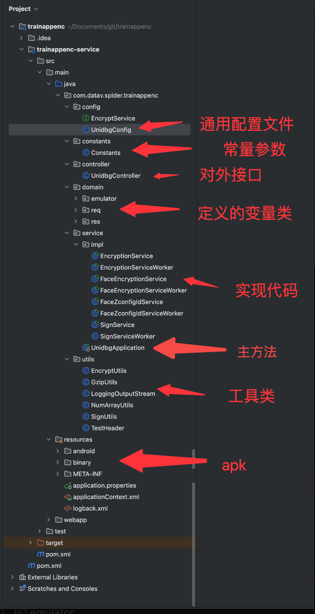
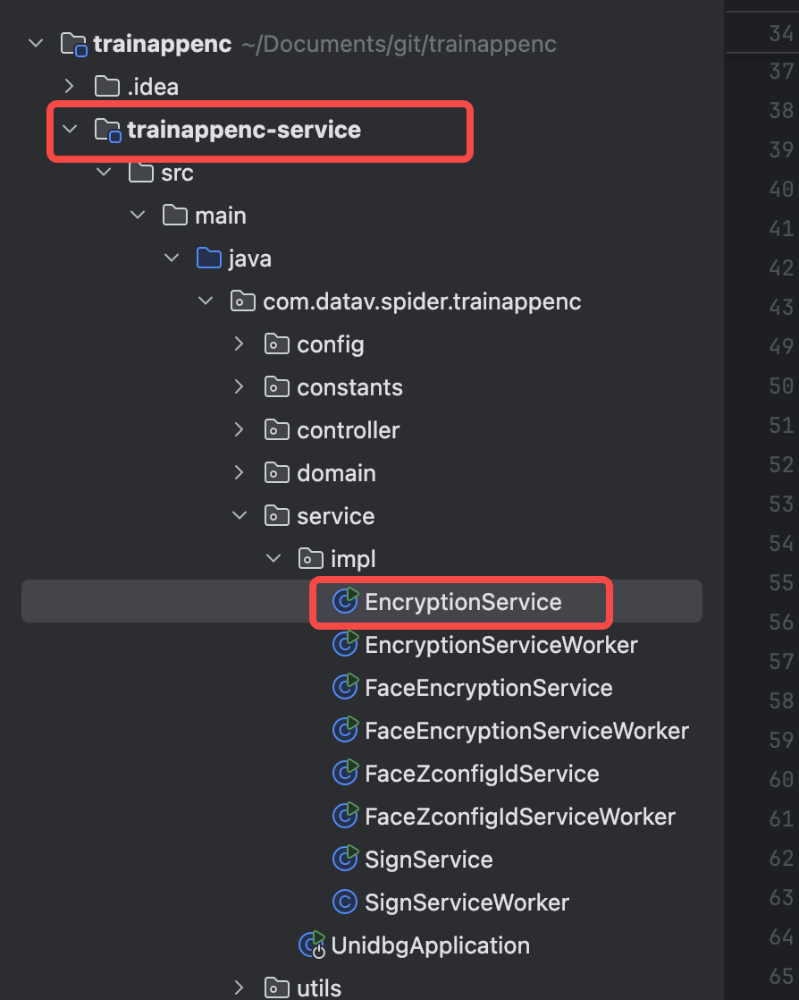
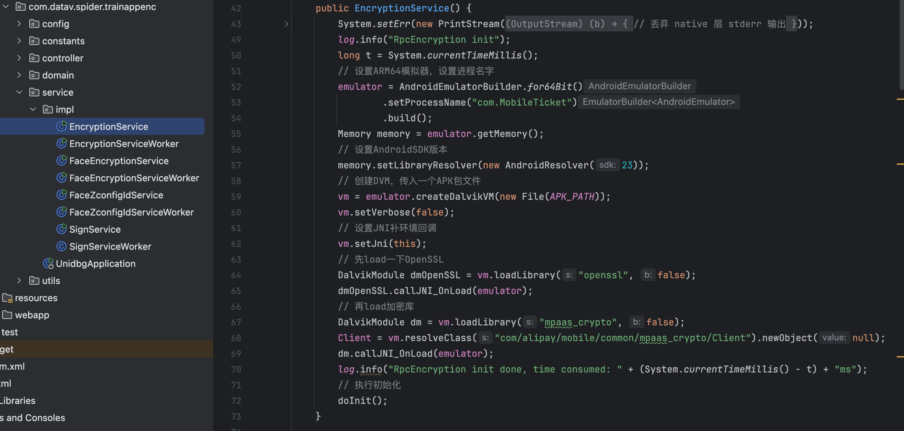
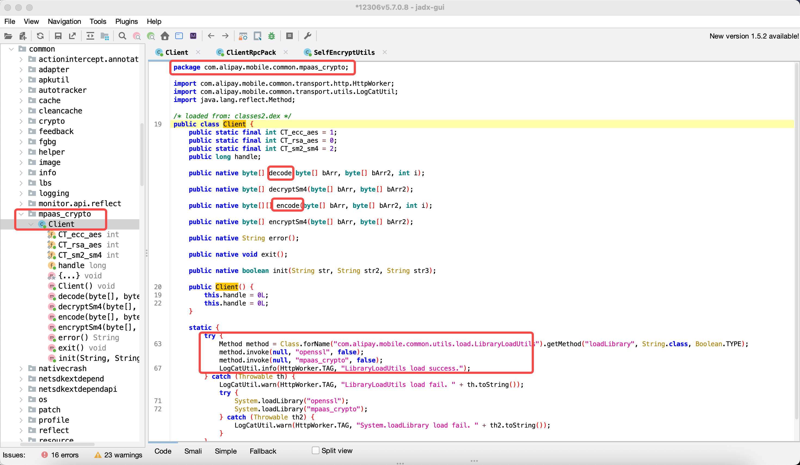
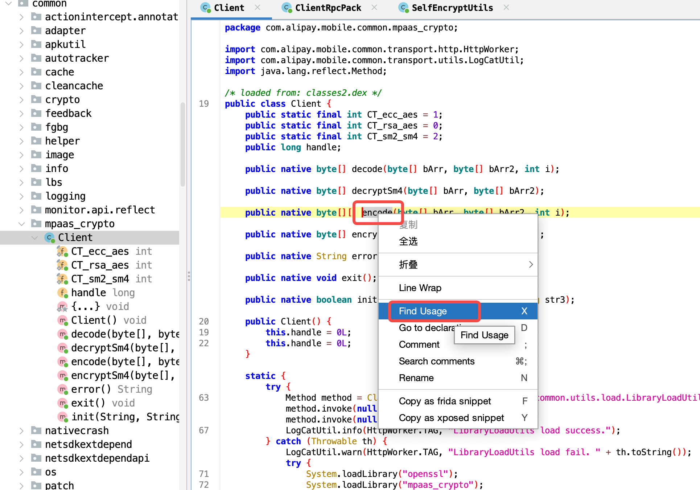
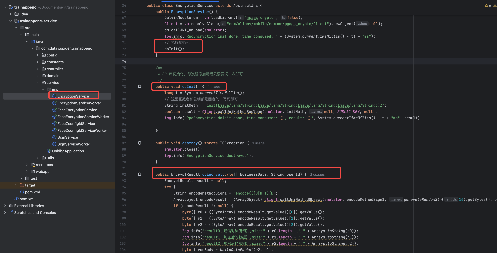
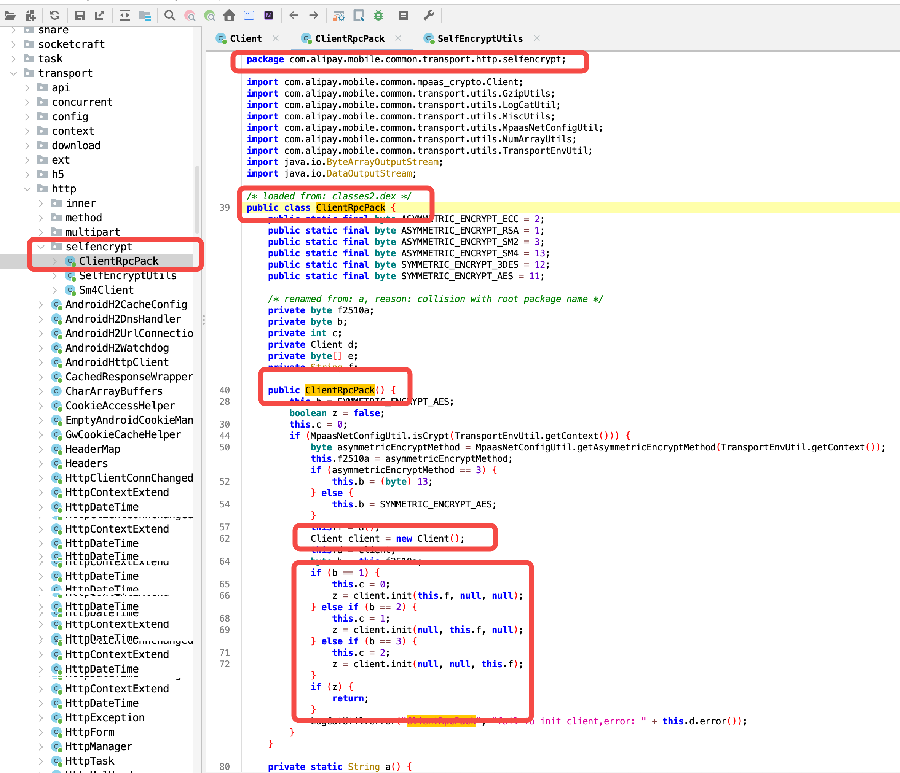
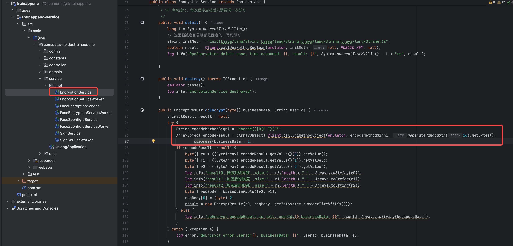
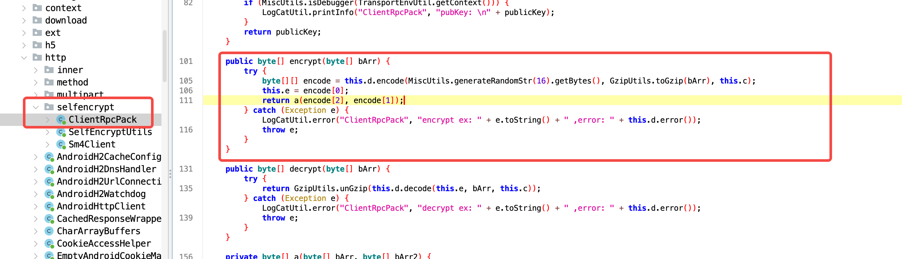

## 一、技术栈

unidbg 本 Java 工程是基于 unidbg 进行开发的

maven 构建工程

Java 11

jadx 用于定位加解密方法的具体实现类

工程需运行在 x86 机器上

## 二、工程目录结构



```python
trainappenc
├── .idea                        ← IntelliJ 配置文件
├── trainappenc-service         ← 主模块
│   ├── src
│   │   ├── main
│   │   │   ├── java
│   │   │   │   └── com.datav.spider.trainappenc
│   │   │   │       ├── config          ← 通用配置类（如 Bean、拦截器等）
│   │   │   │       ├── constants       ← 常量参数定义
│   │   │   │       ├── controller      ← 对外接口（通常是API 控制器）
│   │   │   │       ├── domain          ← 定义变量/参数类（如实体类、DTO）
│   │   │   │       ├── service         ← 业务逻辑实现代码
│   │   │   │       └── utils           ← 工具类（如日期、字符串处理等）
│   │   │   └── resources
│   │   │       ├── android
│   │   │       ├── binary
│   │   │       ├── META-INF
│   │   │       ├── application.properties     ← Spring Boot 配置文件
│   │   │       ├── applicationContext.xml     ← Spring 上下文配置文件
│   │   │       ├── logback.xml                ← 日志配置文件
│   │   │       └── webapp                    
│   │   └── test                               ← 单元测试代码目录
│   ├── target                                 ← Maven 编译输出目录（自动生成）
│   └── pom.xml                                ← 子模块 Maven 配置文件
└── pom.xml                                    ← 项目父级 Maven 配置文件
```

## 三、接口说明

### 1、 接口说明：`controller` 加解密与签名接口

`controller` 提供了一系列与加密、解密、签名相关的接口，主要通过 POST 请求提供服务，接口统一以 `/api` 作为前缀。所有接口均接收 JSON 格式的请求体，返回结构为标准的 `EncryptResponse<T>` 封装格式。以下是主要接口说明：

### 2、 接口统一返回结构：

```json
{
  "code": 1,
  "message": "success",
  "data": { ... }
}
```

其中 `code=1` 表示成功，`code=0` 表示失败，具体失败信息体现在 `message` 字段中。

## 四、详解-以EncryptionService 为示例



### 1、初始化流程



在构造函数中完成：

```python
1、创建 ARM64 Android 模拟器；

2、设置 Android SDK 版本为 23；

3、加载 APK 并创建 Dalvik VM；

4、加载 libopenssl.so，调用 JNI_OnLoad；

5、加载 libmpaas_crypto.so，创建 Client 对象；

6、设置 JNI 桥接类为当前实例；

7、执行 init 初始化函数传入公钥，准备加密环境。
```

### 2、引用 so 和实现类

在代码的 64 、67、68 行可以看到引用的类，其中 openssl、mpaas_crypto 是 12306 中引用的 so 文件，com/alipay/mobile/common/mpaas_crypto/Client 为加解密方法具体的实现类



右键找到 encode 的调用<br>

### 3、代码中执行逻辑

在代码中可以看到，先执行了 doInit()方法，在 jadx 的 ClientRpcPack 类中的同名方法中可以看到先创建了 Client 的对象，然后调用了 ini()方法，所以在加载了 so 文件和 Client 方法后，要先进行 init()





### 4、调用具体的加密方法

可以对比一下，Client 是具体的实现类，emulator 是加载 12306app 的模拟器，encodeMethodSign1 是定义的方法名，后面依次就是传参，byte 类型，byte 类型，int 类型，返回 byte 类型的数据

其中encode(([B[B I)[B 表示为：

```python
JNI 函数签名解析：([B[B I)[B
这是一个方法签名，表示该方法的参数和返回值类型。
1. 整体格式
([B[B I)[B
^     ^ ^
|     | |-> 返回值类型： [B 表示 byte[]
|     |---- 参数3：I 表示 int
|---------- 参数1：[B 表示 byte[]，参数2：[B 表示 byte[]
```





### 5、最后就是补环境，可以参考这个链接 [https://bbs.kanxue.com/thread-285140.htm](https://bbs.kanxue.com/thread-285140.htm)

## 五、参考链接

unidbg 开源代码

[https://github.com/zhkl0228/unidbg](https://github.com/zhkl0228/unidbg)

参考链接

[https://zhupite.com/sec/unidbg.html](https://zhupite.com/sec/unidbg.html)

[https://www.52pojie.cn/thread-1902129-1-1.html](https://www.52pojie.cn/thread-1902129-1-1.html)

[https://bbs.kanxue.com/thread-285140.htm](https://bbs.kanxue.com/thread-285140.htm)
