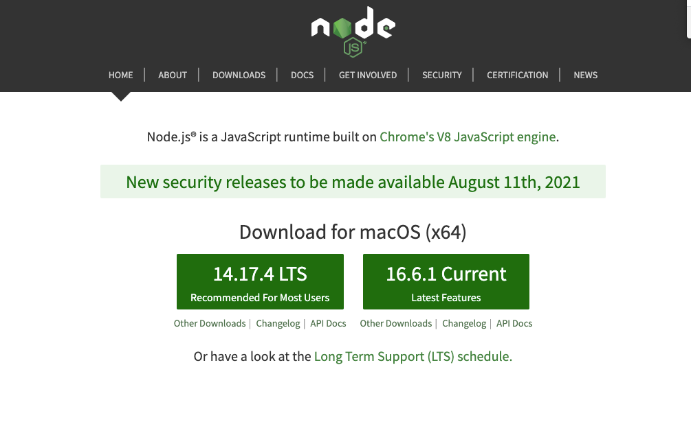

**直接从官网上下载安装**

点击进入网址，[https://nodejs.org/en/#download](https://nodejs.org/en/#download)



点击下载“Current”,下载完成后执行node-v*.*.*.pkg安装完成即可。

首先明确全局模块的默认安装位置：npm root -g

然后添加环境变量 NODE_PATH 值为：nodejs安装目录下node_modules文件夹。也就是上一步命令输出的结果。

注意的是。安装模块最好也是在nodejs安装目录下执行安装命令 例如：npm install jsdom

测试是否安装成功：jsdom

```python
const jsdom = require("jsdom");
const { JSDOM } = jsdom;
const dom = new JSDOM(`<!DOCTYPE html><p>Hello world</p>`);
console.log(dom.window.document.querySelector("p").textContent); // "Hello world"
```

输出

```python
Hello world

Process finished with exit code 0
```
