Charles抓包

web抓包：

app抓包：

# Charles配置

## Windows系统

1、打开Charles，先安装证书并且信任

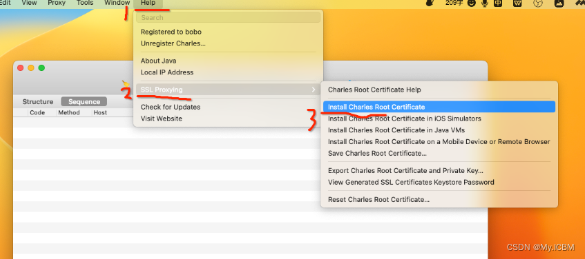

2、证书下载好之后，找到证书文件，双击进行安装证书(I)，将其安装到【受信任】目录中，出现信任选项，点击始终信任即可。

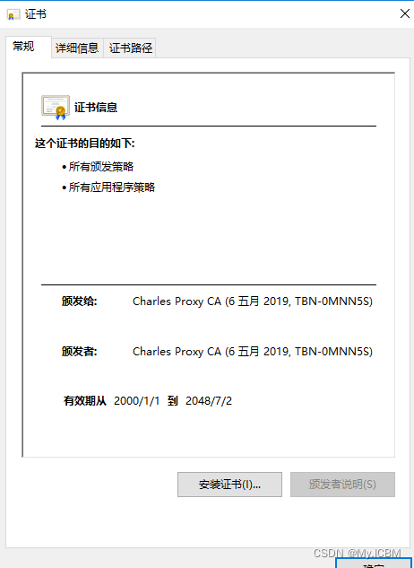

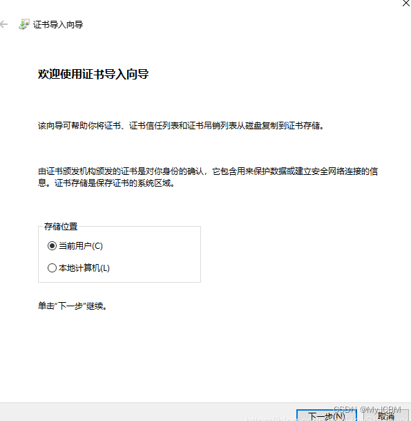

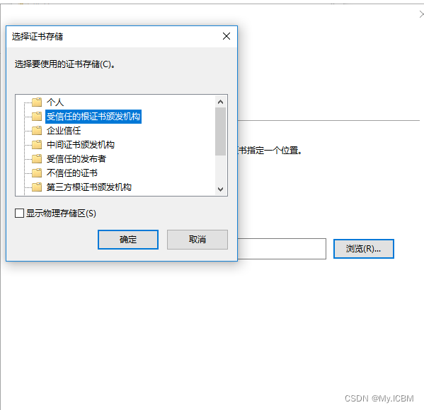

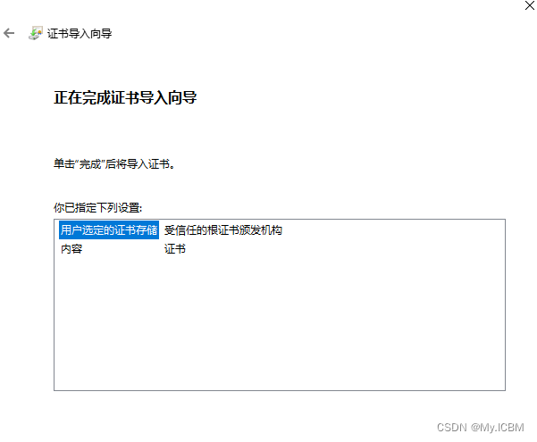

3、点击完成后提示导入成功。此时需要重新进入Help -> SSL Proxying -> Install Charles Root Certificate，查看证书结果，成功时如下提示：

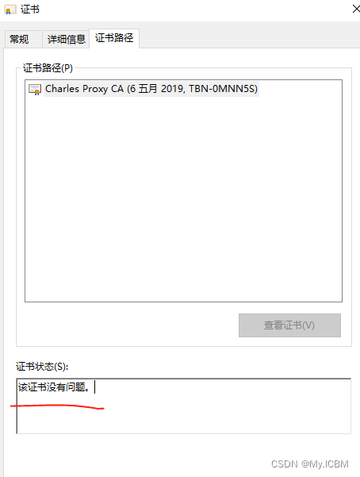

证书状态显示：该证书没有问题就表示导入成功了。

4、设置SSL，保证可以抓取https协议的请求：

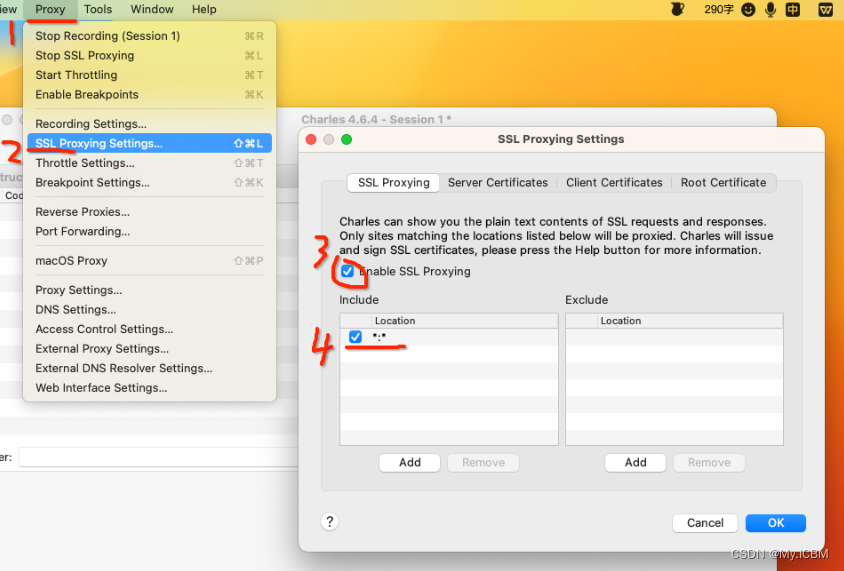

这是端口号：

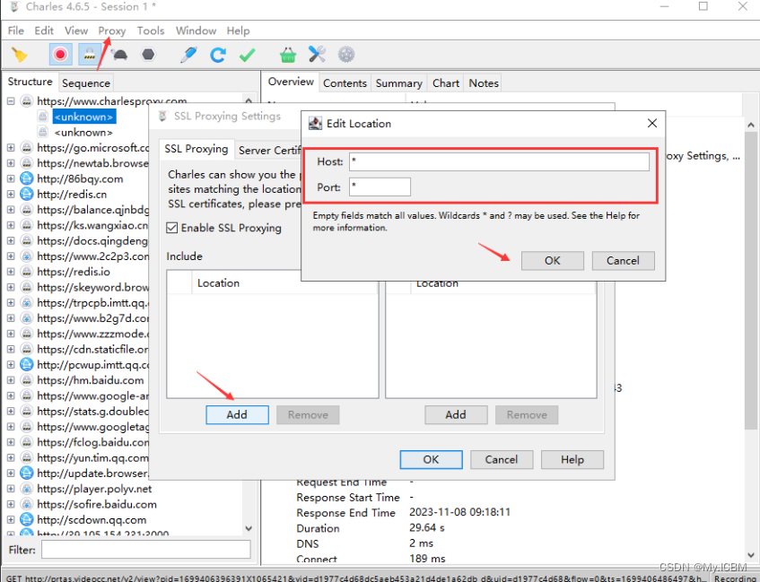

## 苹果系统操作

1、如果是mac操作系统需要如下操作，其他系统忽略该操作：

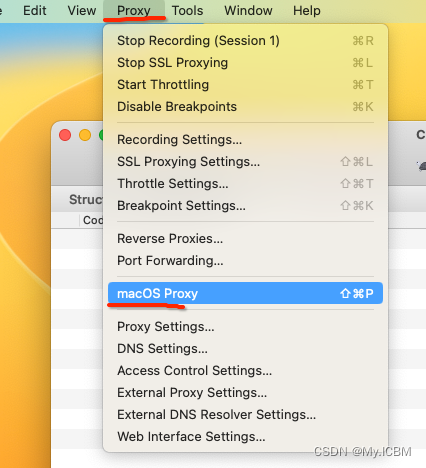

配置完成，可以使用Charles进行抓包了

2、工具栏苹果系统展示：

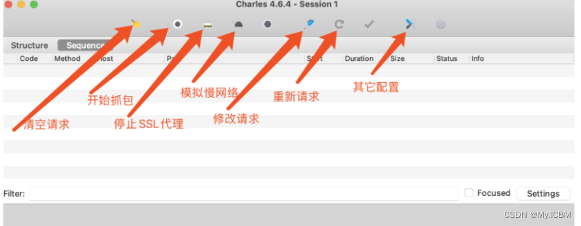

3、工具栏windows系统展示：

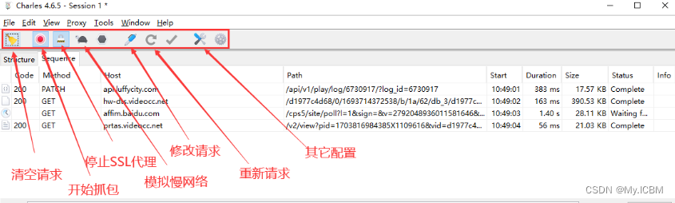

**什么是证书？为何需要证书？**

首先明确一点，安装证书的目的是为了是的抓包工具可以抓取https协议的请求。

**1、http协议是不安全的**

在https诞生之前，所有网站都使用http协议，而http协议在数据传输的过程中都是明文，所以可能存在数据泄露和篡改。

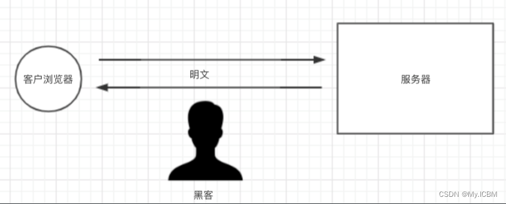

**2、使用对称秘钥进行数据加密**

为了防止数据泄露和篡改，我们对数据进行加密，如：生成一个对称密码【DKUFHNAF897123F】，将对称秘钥分别交给浏览器和服务器端，他们之间传输的数据都使用对称秘钥进行加密和解密。

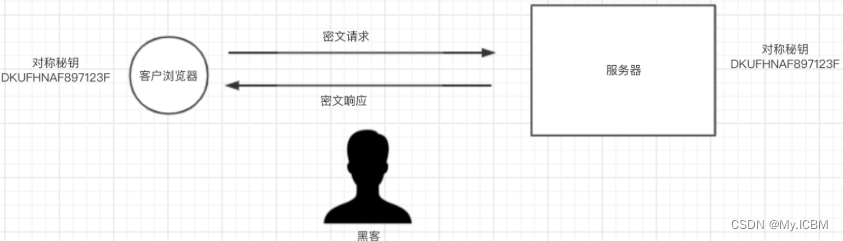

请求和响应流程如下：

1、客户端使用对称秘钥对请求进行加密，并发送给服务端。

2、服务端接收到密文之后，使用对称秘钥对密文进行解密，然后处理请求。 最后再使用对称秘钥把要返回的内容再次加密，返回给客户端。

3、客户端接收到密文之后，使用对称秘钥进行解密，并获取最终的响应内容。

如此一来，数据传输都是密文，解决了明文传输数据的问题。但是，这么干有bug。

1、浏览器如何获取对称秘钥？

2、如果每个客户端的对称秘钥相同，浏览器能拿到对称秘钥，那么黑客也可以拿到，所以，数据加密也就没有意义了。

**3、非对称秘钥加密**

公钥私钥对儿：公钥负责加密，私钥负责解密

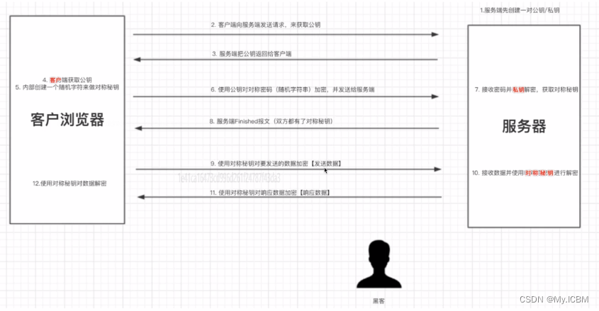

如此一来，解决了 动态对称秘钥 和 数据加密的问题，因为每个用户的对称秘钥都是随机生成且传输的过程中都使用公钥加密（公钥加密的数据只有私钥能解密），所有黑客无法截获对称秘钥。而数据传输是通过对称秘钥加密过的，所以黑客即使能获取数据也无法去解密看到真实的内容。 看似无懈可击，但是，这么干还是又bug：如果黑客在上图 【步骤2】劫持，黑客把自己的公钥返回给客客户端，那么客户端会使用黑客的公钥来加密对称秘钥，黑客在【步骤6】截获请求，使用自己的私钥获取对称秘钥，后面过程全都会完蛋…

**4、CA证书应用**

使用 ca 证书可以解决黑客劫持的问题

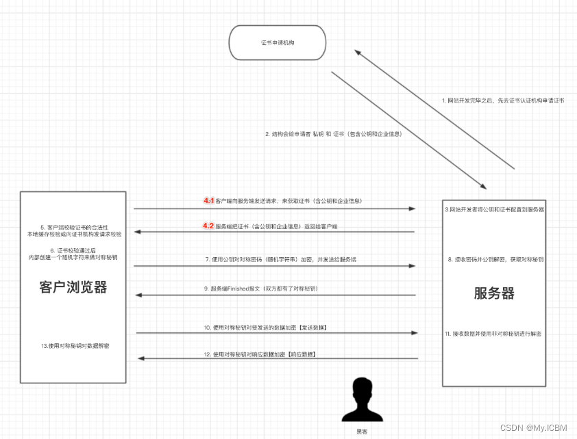

如此一来，就解决了黑客劫持的问题，因为即使黑客劫持后的给浏览器即使返回了证书也无法通过校验，同时浏览器也会提示错误信息。

https可以保证数据安全，但由过程需要反复加密解密所有访问速度会有所下降（鱼和熊掌不能兼得）。

## 完美解决安卓7.0及7.0以上的机子Charles不能抓取 https 请求的问题

### 一、先摆出问题：

如题，今天遇到了一个安卓手机无法抓取 https 请求的问题，提示：Client SSL handshake failed: An unknown issue occurred processing the certificate(certificate_unknown)

如下图所示：

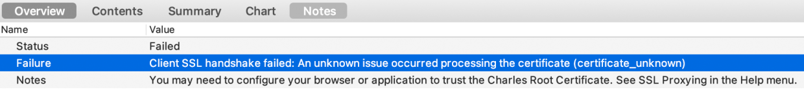

于是我重新检查了一下环境配置：

1. 小米安卓手机与 mac 笔记本连接的是同一个网络；

2. mac 笔记本已经通过 Charles Help ---> SSL Proxying ---> Install Charles Root Certificate 安装了 Charles 证书，并且通过钥匙串已设置完全信任该证书，如下图所示：

3. 小米安卓手机网络设置已设置代理，代理的ip确认是mac 笔记本的 ip，同时端口号已设置8888

4. 小米安卓手机通过谷歌浏览器访问 h[ttp://chls.pro/ssl](https://links.jianshu.com/go?to=http%3A%2F%2Fchls.pro%2Fssl)链接，成功下载到证书，并按照手机的提示将证书名称改为 1.crt 。点确定后，手机提示成功安装该证书。

5. 通过手机系统设置 ---> 更多设置 ---> 系统安全 ---> 已信任的凭据信息 ---> 用户 界面中，能看到 charles 证书确实已成功安装。

排查了一圈，没发现哪里有问题。要是换作是 iOS（操作步骤跟上面的大同小异），都到这一步了肯定是没问题的。我重新打开 安卓的 app 再尝试抓包，发现还是不行。于是我重启了安卓手机，再尝试抓包，还是不行。摸不着头脑的我只能开始在网上寻找答案。

### 二、后面终于找到了解决方案：

前提：在手机端和电脑端都必须安装 https 的安全证书；

配置：打测试包时，项目设置默认信任所有证书（系统+用户）

（1） 在工程 res-xml 目录中创建一个名为 network_**security_**config.xml 的文件，文件内容如下：

<?xml version="1.0" encoding="utf-8"?>

<network-security-config>

<base-config cleartextTrafficPermitted="true">

<trust-anchors>

<certificates src="system" overridePins="true" />

<certificates src="user" overridePins="true" />

</trust-anchors>

</base-config>

</network-security-config>

（2） 在 AndroidManifest 里的标签中，添加如下代码：

android:networkSecurityConfig="@xml/network_security_config"

重新打包项目，然后抓包，即成功了。

你以为到这就结束了？然而并没有。

### 三、我还是有个疑问，上面的例子只适合能够修改源码并能重新打包或者是真机调试的情况。

如果是之前已经打好的包突然某个接口网络请求出问题只能采取抓包的方式来解决，并且之前并没有添加上面的代码的情况，那又该怎么呢？

接下来要敲重点了：Android 7.0及7.0以上的机子改变了安全策略，默认不信任用户添加到系统的 CA 证书：

To provide a more consistent and more security experience accross the Android ecosystem,beginning with Android Nougat, compatible devices trust only the standardized system CAs maintained in AOSP.

翻译：

为了在Android生态系统中提供更一致、更安全的体验，从Android Nougat开始，兼容设备只信任AOSP中维护的标准化系统CA。

也就是说对基于 SDK24 及以上的 App 来说，即使你在手机上安装了抓包工具的证书也无法抓取 https 请求。

解决方案：

**将抓包工具的证书添加到系统证书中！**效果如下图所示：

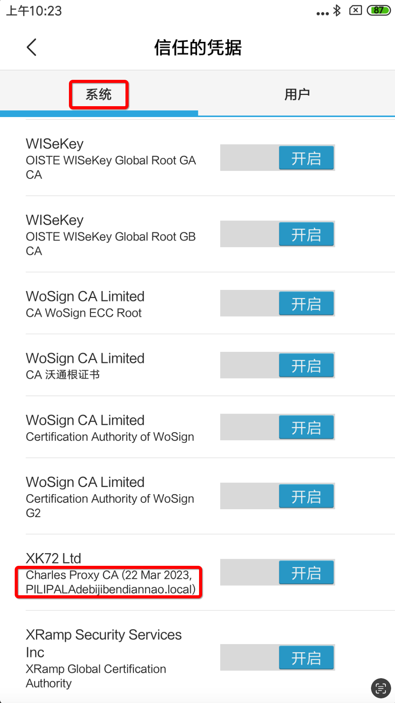

### 四、实践步骤：

1、需要先获取你的安卓测试机 root 权限。我用的是红米手机，获取 root 权限操作如下：设置 ---> 授权管理 --> 开启ROOT权限 即可。之后手机会重启，重启之后即可成功 root 。

2、通过 电脑端的 Charles 拿到后续要安装到手机上的证书步骤也很简单：

Charles 菜单栏 ---> Help ---> SSL Proxying ---> Save Charles Root Certificate。选择要保存的路径即可。如下图所示：

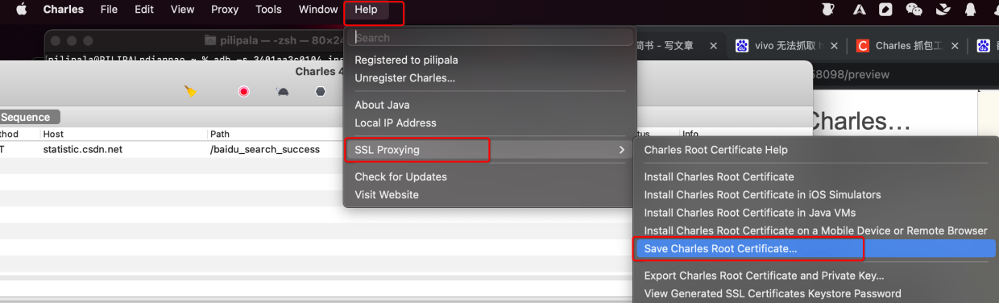

3、通过 电脑端的 Charles 拿到后续要安装到手机上的证书，并通过 openssl x509 -subject_hash_old -in 命令计算出它的哈希值。并将证书重命名为 哈希值.0 或者哈希值.1

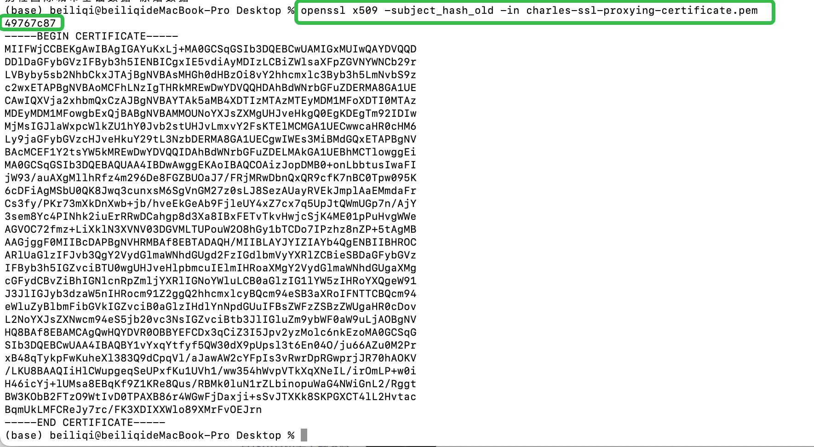

命令如下：

openssl x509 -subject_hash_old -in charles-ssl-proxying-certificate.pem

4、证书重命名如下图所示：

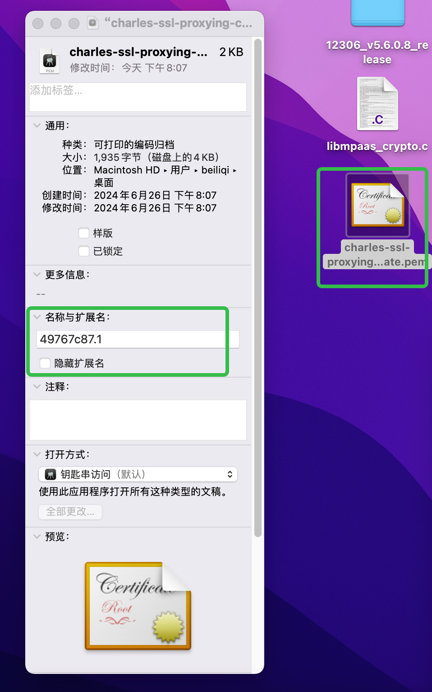

**注意**：这一步必须保证证书没有隐藏后缀名，可以点右键，显示简介，将隐藏后缀名的勾去掉。将后缀名置为1或者0 。系统会提示你是否确认使用该后缀，点确定即可。

5、root 成功的安卓测试机连接电脑。我这里用是 mac 笔记本。接下来是mac 通过终端来操作：

打开终端，通过终端将当前的工作目录切换到第二步保存证书的所在目录，我这里是将证书直接保存到家目录下的 Download 目录下。所以切换工作目录的命令如下：

cd /Users/beiliqi/Desktop; clear; pwd

安卓系统的安全证书是在 /system/etc/security/cacerts 目录下的，终端输入 adb shell ，打开目录就能看到这些证书，如下图所示：

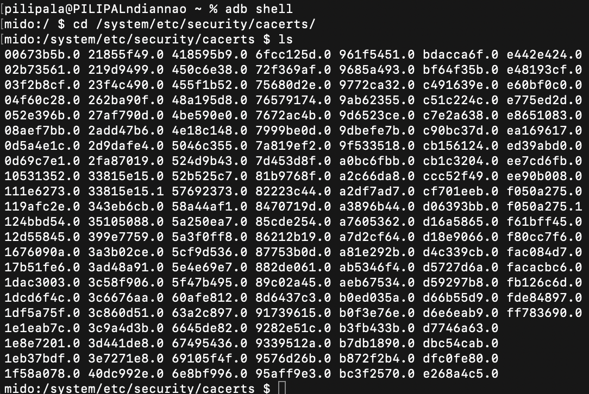

我们最终目标是要将安装到手机端的证书添加到该目录下。而在这之前，我们得先将证书发送到手机端的 sdcard 的 Download 目录，再将证书从手机端的 sdcard 的 Download 目录复制到安卓系统的安全证书目录。

接着输入 adb push 命令将证书推给手机端的 sdcard 的 Download 目录。命令如下：

adb push 49767c87.1 /sdcard/Download

注意看终端的提示，此时终端很快会提示你有一个文件被 pushed，即 push 成功。如下图所示：

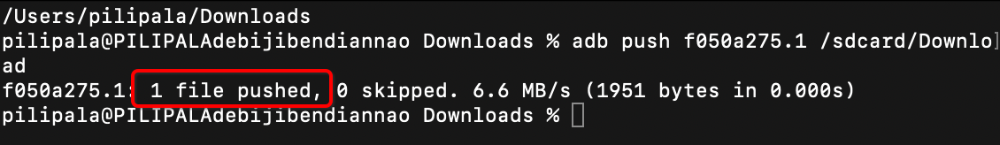

这一步很关键，需要将 /sdcard/Download 目录下的证书复制到系统证书的所在目录。命令如下：

cp /sdcard/Download/f050a275.1 /system/etc/security/cacerts/f050a275.1

然而我复制的时候提示我证书是一个 ReadOnly 文件。如下图所示：

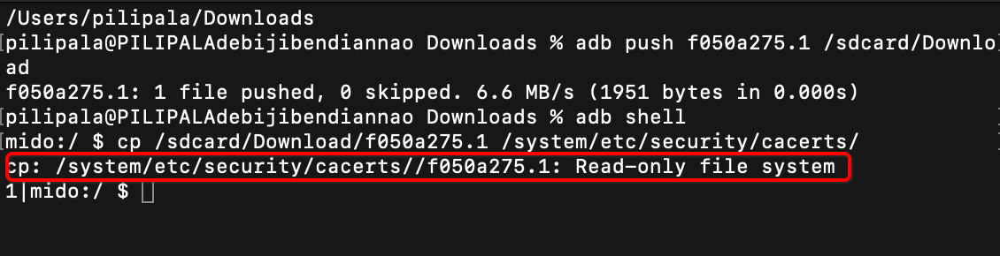

通过测试，发现关闭手机安全验证机制的方案是可以解决的，命令如下：

# 进入命令行

adb shell

# 进入超级管理员, 进入后由$变为#号

su

# 更改权限

chmod 777 system

# 重新挂载system，若失败可以尝试重启手机

mount -o rw,remount -t auto /system

# 或

mount -o remount,rw /system

手机重启后，再次执行上面的 cp 命令，如果终端没有任何提示，即复制成功，看到胜利的曙光了。

### 五、接着，赋予证书执行的权限。

chmod 644 /system/etc/security/cacerts/f050a275.1

### 六、最后重启手机即可。

到这里，再打开手机设置 --> 更多设置 --> 系统安全 --> 信任的凭据 --> 系统，就能看到抓包工具的证书已经被我们成功添加进来了。默认是开启信任的。如果没有，打开信任即可。

再重新抓包，就能发现 https 的请求也能抓取到了。

### 七、写在最后

证书重命名那一块，一般会将证书重命名为：哈希值.0，如果安卓系统的安全证书目录下已经存在相同哈希值的证书，可以将证书的后缀名重命名为 .1 。再将证书复制到安卓系统的安全证书目录下。

其他品牌的手机（如 vivo等）我没试过，不过操作步骤应该是差不多的。

## 参考链接

**双向认证**

原文链接：[https://bbs.kanxue.com/thread-265404.htm](https://bbs.kanxue.com/thread-265404.htm)

原文链接：[https://blog.csdn.net/weixin_43612602/article/details/135287720](https://blog.csdn.net/weixin_43612602/article/details/135287720)

原文链接：[https://www.jianshu.com/p/06ccefcdbcd2](https://www.jianshu.com/p/06ccefcdbcd2)
